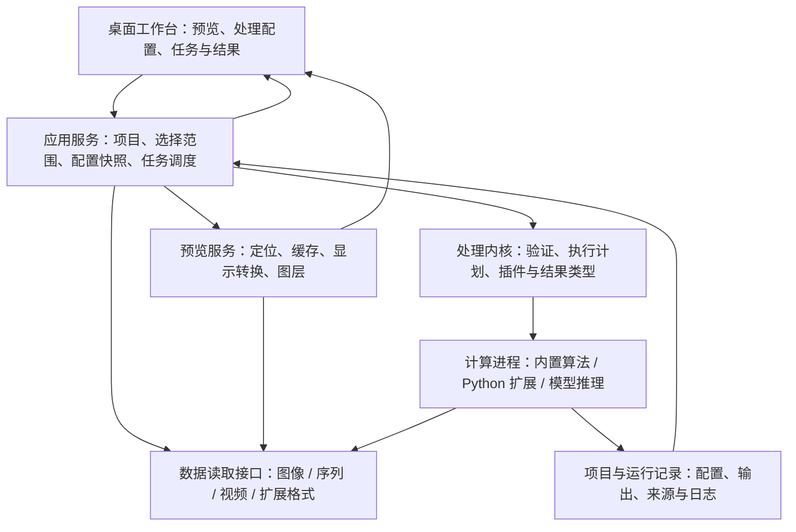

# 高级图像与视频处理器：框架规划

状态：已建立 Git 仓库，实现阶段 A 的 `0.1.0` 贯通基线；`0.2.0` 将默认前端迁移为本机 Web 工作台，`0.3.0` 完善导入、ROI 编辑、独立显示及可追溯的处理结果串联，`0.3.1` 接入灰度 CINE、精确帧定位及采集帧/触发时间记录，继续复用 Python 内核。实际支持范围、启动方法和未实现项见 [README.md](README.md)。本文保留完整目标规划，功能优先级不表示全部功能已经实现。

## 1. 产品定位与不可偏离的主线

主工作流：**打开图像、图像序列或视频 → 预览并定位数据 → 配置处理 → 检查局部结果 → 运行完整任务 → 对比与导出。**

两个核心始终可见、互相贯通：

1. **视频数据预览**：可靠地打开、播放、定位、检查和比较数据；既是查看器，也是确定处理范围和验证结果的工作台。
2. **数据处理**：统一支持内置方法、自定义算法和机器学习方法；从快速试算到完整处理，参数、数据语义和结果来源保持一致。

新增功能必须服务其中一项，并说明与另一项如何连接。例如，ROI 是预览中的空间选择，也是处理的范围；时间轴是观看入口，也是处理区间；结果图层用于显示，也用于检查算法输出。

框架先形成完整可用的闭环，再扩展格式、算法和规模。第一版不以算法数量、节点数量或页面数量衡量完成度。

## 2. 暂定前提与待确认项

以下是推进规划使用的假设，不代表用户已确认：

| 项目 | 暂定方案 | 对架构的影响 |
| --- | --- | --- |
| 运行方式 | 本机 Web 工作台；当前验证 Windows，接口保持可跨平台 | 浏览器交互、本机文件访问、独立后台计算 |
| 数据范围 | 常规视频、科研图像及时间序列混合 | 明确时间戳、位深、通道、维度及显示转换 |
| 计算规模 | 单机中大型数据；CPU 可用，GPU 可选 | 按需读取、有界缓存、计算进程隔离 |
| 专业扩展 | Python 算法优先；模型推理作为首个 ML 扩展 | 算法接口独立于界面与具体推理框架 |
| 项目组织 | 本地项目文件与结果目录 | 无账号、云服务或服务器的必要依赖 |

需要补充的实际边界：主要文件格式、典型与最大数据体量、帧尺寸/位深/通道、视频时长与帧率、目标硬件、第一批算法及输出要求。多通道、多层、多文件并不自动意味着必须支持完整医学或显微格式标准。

进入开发后，用用户的代表性文件确定格式白名单和性能验收基线。尚未测量前，不承诺任意格式、任意规模或固定实时处理速度。

## 3. 两个核心的功能地图

优先级：P0 为第一轮可用框架；P1 为专业能力扩展；P2 在真实需求出现后实施。架构可预留接口，但预留不等于首版实现。

### 3.1 视频数据预览

| 能力 | 具体行为 | 与处理的连接 | 优先级 |
| --- | --- | --- | --- |
| 数据打开 | 文件选择、拖放、最近打开、读取失败原因 | 生成同一种输入描述 | P0 |
| 视频及序列浏览 | 播放/暂停、单步、首尾定位、速度调节、循环选区 | 当前帧、选定时间段成为试算范围 | P0 |
| 时间定位 | 展示帧序号和真实时间戳；跳转后显示实际定位结果 | 固定正式处理的时间范围 | P0 |
| 基础查看 | 缩放、平移、适应窗口、像素原值查询 | 识别异常和验证数值变化 | P0 |
| 显示调节 | 窗宽/窗位或范围映射、亮度对比度、伽马、伪彩色 | 只改变显示，不暗中改变算法输入 | P0 |
| 高位深数据 | 保留支持格式的 uint16/浮点原值，单独生成显示图像 | 算法获得原始数值及 dtype | P0 |
| 空间范围 | 矩形 ROI；清楚显示范围是否作用于处理 | 同一 ROI 可试算、正式运行和导出 | P0 |
| 输入结果对比 | 同帧切换、同步并排、结果叠加 | 评估处理效果 | P0 |
| 数据信息 | 尺寸、位深、时间信息、来源、颜色/通道解释 | 揭示输入前提 | P0 |
| 大文件交互 | 按需读帧、有界缓存、邻近帧预取 | 为处理保留资源 | P0 |
| 通道与多维浏览 | 明确 T/Z/C 轴及 RGB 样本含义；按轴选择 | 处理范围可覆盖指定轴 | P1 |
| 直方图与剖面 | 原始数值直方图、线剖面、ROI 统计与曲线 | 检查强度和时序特征 | P1 |
| 复杂 ROI | 多边形、掩膜、多个区域、保存与复用 | 区域分析与标注 | P1 |
| 标签与热图 | 标签图、轮廓、置信度、向量叠加；图例明确 | 显示模型/算法输出 | P1 |
| 多源同步 | 按时间戳或已定义映射同步；显示未对齐状态 | 比较不同数据或不同运行 | P1 |
| 超大图像 | 分块读取、多分辨率显示、按需加载 | 分块计算与可视化 | P2 |
| 三维查看 | 对有明确需求的体数据提供正交切面等 | 体数据处理验证 | P2 |

单张图像使用同一预览画布，隐藏无意义的播放控件。图像序列需要显式排序规则和时间间隔；不能把文件名字典序默认为真实时间顺序。

### 3.2 数据处理

| 能力 | 具体行为 | 预览反馈 | 优先级 |
| --- | --- | --- | --- |
| 输入验证 | 检查轴、dtype、范围、算法支持能力和必要元信息 | 运行前定位可修复问题 | P0 |
| 处理范围 | 当前帧、时间段、全部数据；矩形 ROI | 画布和时间轴明确标记 | P0 |
| 顺序处理链 | 添加/启用/禁用/排序步骤；校验类型与前后依赖 | 查看指定步骤的输出 | P0 |
| 参数面板 | 类型、默认值、范围、单位、重置和预设 | 显式触发试算；可选防抖自动试算 | P0 |
| 内置基线算法 | 用少量强度变换、滤波、阈值和统计方法验证接口 | 有可人工验证的输入输出 | P0 |
| 自定义算法 | 注册 Python 插件；声明输入输出、参数及资源 | 通过统一接口显示输出 | P0 |
| 快速试算 | 当前帧/局部窗口运行；显示实际采样范围 | 与正式任务共用算法实现 | P0 |
| 后台任务 | 队列、进度、取消、失败详情、单任务重试 | 界面与预览保持可操作 | P0 |
| 完整运行 | 按帧/块推进；有限内存；保存运行配置 | 结果作为独立可查看数据源 | P0 |
| 批处理 | 同一处理链作用于多个输入；逐文件状态 | 成功、失败、取消分别统计 | P0 |
| 输出与记录 | 处理图像/序列、表格、配置与日志导出 | 导出后可重新打开核验 | P0 |
| ML 推理 | 权重与输入规范绑定；设备选择；预后处理显式配置 | 显示标签、概率、图像或表格 | P1 |
| 时空专业算法 | 配准、相关分析、时序分析、跟踪等由插件承载 | 同步对比、曲线或轨迹 | P1 |
| 参数探索 | 有界参数扫描；比较对应运行结果 | 指标与图像联合评估 | P1 |
| 可恢复计算 | 仅对实现检查点的算法支持暂停/恢复 | 显示可恢复位置与限制 | P1 |
| ML 训练/微调 | 数据集、标注、训练任务和指标的独立扩展 | 模型回到同一推理入口 | P2 |
| 多输入处理图 | 在确有分支、汇合需求时扩展 DAG | 呈现输入与结果关系 | P2 |
| 多 GPU/远程计算 | 替换计算后端；显式数据传输和资源配置 | 保持任务与结果协议 | P2 |

首版使用顺序处理链。算法不能接收上一阶段的输出时，应在运行前给出具体原因，而不是允许提交后再崩溃。

## 4. 首个主界面

直接进入工作台，不增加欢迎页作为主路径。

```text
┌ 打开数据 / 项目     保存项目     视图     运行 / 取消 ─────────┐
│ 数据源与结果       │ 预览：输入 / 结果 / 同步对比 │ 处理链      │
│ 文件、序列         │ 缩放、ROI、像素值、显示范围 │ 步骤及启用  │
│ 当前任务结果       │ 主图像/视频画布            │ 参数与范围  │
│ 数据属性           │                            │ 试算 / 运行 │
│                    │ 时间轴、帧、时间、播放控制 │ 输出设置    │
├ 任务队列：状态、范围、进度、输出位置、取消 / 重试 ────────────┤
│ 状态栏：读取/计算状态、简要错误；详细日志按需展开              │
└────────────────────────────────────────────────────────────┘
```

- 预览与处理配置在同一窗口，选中结果不会悄悄替换处理链的输入。
- 显示设置归属于视图，处理参数归属于处理链；两者分别保存。
- 修改参数只产生“配置已修改”状态，正式运行仍需明确触发。
- 每个结果显示来源数据、运行标识和参数版本；旧结果不会被新参数重新贴上名称。
- 任务区域可折叠，数据源区域可收窄；小窗口仍保留画布、当前处理步骤和运行按钮。
- 信息密度以研究工具为准，使用清楚的分组、单位、数值和状态；不增加装饰性信息面板。

## 5. 系统架构



### 5.1 关键边界

1. **UI** 只管理交互和展示，不直接执行解码、模型加载或批处理。
2. **数据读取层** 负责发现、描述、按范围读取与关闭；算法不直接依赖具体视频容器或图像文件库。
3. **预览层** 管理定位、显示分辨率、视图坐标及图层；显示转换不是隐式预处理。
4. **处理内核** 管理类型验证、范围解析、算法执行计划和结果协议，不依赖 GUI。
5. **计算进程** 执行用户方法和重计算；异常、内存耗尽或依赖冲突有明确任务归属。
6. **项目与结果层** 保存路径、元数据、配置和来源关系；不把大型图像数组塞进项目 JSON。

预览和计算可以使用同一读取适配器，但各自持有独立 reader/解码器实例。播放改变解码位置时，不能影响正在运行的任务。

### 5.2 候选技术方案

- 当前前端：浏览器 HTML/CSS/JavaScript + Canvas；本机 FastAPI 服务提供来源、预览和任务接口，原始数组保留在后端。仅监听本机，同源会话访问，不依赖云端。[FastAPI 官方文档](https://fastapi.tiangolo.com/)
- Qt 兼容入口：Python + PySide6 已完成初始基线，保留用于兼容，默认不再进入该界面。[Qt for Python](https://doc.qt.io/qtforpython-6/)
- 图像数据：NumPy 数组作为首个计算载体，明确轴、dtype、坐标及单位；具体文件读写放在适配器中。
- 常规视频：PyAV / FFmpeg 作为候选解码后端；在 reader 中处理时间戳、关键帧跳转和像素格式转换。PyAV 的 seek 定位附近关键帧，精确目标还需要继续解码；不能依赖直接按帧号 seek。[PyAV Containers](https://pyav.basswood.io/docs/stable/api/container.html)
- 后台执行：首版单独 worker 进程与有界任务队列；通过明确消息协议通信。
- 模型推理：提供 RuntimeAdapter；ONNX Runtime 为候选首个运行时，原生 Python/其他模型框架通过后续适配器接入。Execution Provider 按优先级和节点支持能力分配执行，选了 GPU 不代表所有节点都在 GPU 上运行。[ONNX Runtime Execution Providers](https://onnxruntime.ai/docs/execution-providers/)
- 配置：版本化 JSON；首版结果以文件及运行目录组织，不引入数据库。
- 渲染：先验证常规画布的准确显示和交互，再按实测需要添加 GPU 或分块渲染。

不在规划阶段锁定具体依赖版本。进入实施前，用代表性文件验证读取和显示，用代表性算法验证扩展、性能与部署方式。发布包需要核对实际 Qt 模块及 FFmpeg 构建的许可和分发要求，不能仅依据库名推断。[Qt 官方分发说明](https://www.qt.io/development/open-source-lgpl-obligations)、[FFmpeg 官方许可说明](https://ffmpeg.org/legal.html)

首版 reader 接口包含元信息、读帧、范围迭代和关闭；随机定位、精确索引、区域读取、多分辨率读取分别作为能力声明。界面和执行计划据此启用功能，不假设每种来源都具备所有读取能力。

## 6. 数据与结果契约

统一模型描述数据语义，不要求所有文件被整体加载，也不要求所有数据转换成同一种位深。

| 对象 | 必要信息 | 必须满足的约束 |
| --- | --- | --- |
| `DataSource` | 稳定 source_id、路径/来源、流标识、读取适配器、内容修订标识 | 来源变化会使相关缓存失效 |
| `DataSpec` | axes、shape、dtype、有效位深、颜色解释、像素/空间单位、时间信息、读取能力 | 时间来源区分记录值、用户指定值和估算值 |
| `FrameRef` | 来源修订、流、确定的索引或读取位置、实际时间戳 | 索引未知时不编造绝对帧号；身份不随视图改变 |
| `Selection` | 来源、帧/时间范围、Z/C 选择、ROI、坐标空间 | 范围可序列化；运行前冻结 |
| `DataBlock` | 数组/块引用、实际轴顺序、原始位置、时间戳、空间变换 | 块不丢失与原数据的对应关系 |
| `PipelineSpec` | 有序步骤、插件版本及代码摘要、参数、步骤开关 | 保存配置快照，不依赖界面临时状态 |
| `RunSpec` | 来源修订、Selection、PipelineSpec、设备、随机种子及输出设置 | 创建后不可由界面改写 |
| `ResultArtifact` | 结果类型、路径/载入方式、DataSpec、来源映射、run_id | 输出可追溯且可重新读取 |

轴名称采用显式约定：`T` 时间、`Z` 深度、`C` 科研通道、`Y/X` 空间；`S` 可用于 RGB/RGBA 样本。RGB 的颜色样本与独立科研通道不得被混为一谈。

结果类型至少区分：

- `ImageData`：灰度、彩色或浮点结果图像。
- `LabelData`：离散标签及类别映射，不能按连续强度解释。
- `TableData` / `CurveData`：测量、统计与时序结果，保留列单位和轴意义。
- `VectorData`：点、轮廓、轨迹等空间结果，携带原始坐标映射。

未声明或无法显示的结果类型应保留文件与元信息，并明确“暂不支持此类显示”；不能伪装成空白图像。

视频的首个默认算法输入是适配器声明的解码像素。记录颜色转换、dtype 和像素格式；有损视频的解码像素不能被描述为无损传感器原值。PyAV 提供不同像素格式及数组转换；统一使用 `rgb24` 不能用来保证高位深保留。[PyAV Video](https://pyav.basswood.io/docs/stable/api/video.html)

读取与算法验证需要明确浮点 NaN/Inf、缺帧、空 ROI、颜色范围及元信息缺失的处理方式。保留、忽略、填充或拒绝都应有记录，不能静默转换。

## 7. 算法与机器学习扩展

### 7.1 统一插件入口

内置算法与外部插件使用同一契约，避免把自定义方法限制在最后一层“脚本按钮”。首版先支持本地注册的 Python 插件。

插件描述至少包含：

```text
plugin_id / version / entry_point
input_spec / output_spec
parameter_schema：类型、默认值、边界、单位
execution_mode：单帧、时序窗口、分块或整体
capabilities：支持轴、dtype、ROI、CPU/GPU、取消、检查点
context_requirements：时间邻域、空间 halo、全局统计要求
environment_ref：执行环境及依赖说明
```

最小语义接口：

```text
describe()                         → 插件与参数描述
validate(input_spec, parameters)    → 错误/警告及支持的执行方式
prepare(run_context, parameters)   → 可复用的运行资源
execute(data, selection, context)   → 声明类型的结果
finalize(context)                  → 可选的序列汇总结果
close()                            → 释放资源
```

这是接口草案，开发时根据实际算法固化。需要全序列或迭代状态的算法通过任务级执行接口接入，不能强行逐帧切碎。模型在任务生命周期内加载并复用，不在每帧重复加载。

插件可以返回图像、标签、表格、曲线或轨迹。输入读取、分块遍历和落盘由宿主管理；context 提供取消检查、进度、日志和资源。支持多输入/多输出时，必须声明端口与关联语义；首版 UI 只实现必要的顺序连接。

### 7.2 自定义环境

- 插件描述与插件执行分开；不能为了生成参数面板就在 UI 进程导入任意用户模块。
- 首版内置方法使用受控应用环境；外部方法可引用独立 Python 环境，由 worker 启动器选择。
- 环境缺失或依赖不满足时，在运行前报告，不让应用启动时一起失败。
- 首版可采用“配置文件注册 + 参数表单”，不必加入完整代码编辑器和包管理界面。
- 进程隔离用于故障与依赖隔离，并不构成 Python 代码的安全沙箱。

### 7.3 机器学习路径

首个目标为模型推理：选择模型/权重 → 检查输入 → 配置设备和预处理 → 试算 → 正式推理 → 对比与导出。

模型描述必须绑定轴顺序、输入尺寸、dtype、通道顺序、归一化、输出解释和后处理。模型文件并不天然提供所有科学含义，缺失项需要显式补充。

CPU/GPU 可用性、显存不足、模型加载失败和运行时不支持必须可解释。若允许回退 CPU，应由策略明确允许并在运行记录与界面显示，不能静默更换设备。

按块推理需声明 overlap/halo、边缘填充及拼接策略；缩放输入、缩放输出和坐标还原要可检查。记录权重摘要、运行时版本及设备配置。随机种子是可复现信息的一部分，不是跨硬件完全一致的保证。

训练、微调和标注作为后续独立模块；保留模型资产、数据选择和任务接口，使其可接回同一推理与结果体系。首版不搭通用训练平台。

## 8. 预览试算与正式处理的一致性

两种模式共用插件、参数验证和数值处理实现。不同的是范围、资源预算、输出位置和是否持久化。

| 模式 | 默认范围 | 用途 | 必须展示的信息 |
| --- | --- | --- | --- |
| 原数据预览 | 当前帧/显示切片 | 查看与选择 | 实际帧、时间、显示映射 |
| 处理试算 | 当前帧或必要邻域、当前 ROI | 检查效果与参数 | 实际输入范围、采样/缩小、近似状态 |
| 正式任务 | 冻结的指定范围或全部数据 | 获取完整结果 | 配置快照、进度、输出和运行状态 |

时序算法不能把“单帧试算”当作正式时序结果。处理依赖全局归一化、背景估计或整段统计时，应提供正式统计、明确标记局部近似，或者禁用不能成立的试算方式。

ROI 必须声明“仅选择输出区域”还是“裁剪算法输入”。有空间邻域或全局上下文的方法需要外扩、全帧计算后裁剪，或者明确说明局部边界效应。

输入范围、参数和插件版本共同决定试算标识。修改配置后标记旧结果过期；异步返回的旧请求不可覆盖新请求结果。正式输出不使用显示缩略图作为数值输入，除非用户明确选择并记录降采样。

第一种试算为“精确试算”，保持输入精度并补齐必要上下文；可选的“快速预览”允许抽帧/降采样，醒目标明条件。裁剪、缩放、配准等步骤后，由坐标映射解释后续选区和叠加结果，不能继续沿用已经失效的原始坐标。

## 9. 视频定位、性能与资源策略

### 9.1 视频定位语义

- 区分源数据帧索引、显示时间和容器时间基。可变帧率不能用 `帧号 ÷ 平均帧率` 代替真实时间。
- 视频 seek 是跳转起点；精确目标需要根据适配器能力从关键帧继续解码并定位。未知全帧索引时可逐步建立，不能为了打开文件先扫描完整长视频。
- 精确时间跳转定义为选择不早于目标的可显示帧；到尾部时选最后可显示帧，并返回实际时间。按帧号跳转以索引能力为前提，不能用估算帧号冒充精确帧号。
- 拖动时间轴时可使用明确标识的快速定位；松手后精确解码目标并更新实际帧/时间。快速定位请求的过期结果同样必须丢弃。
- 播放为保持交互可采用丢弃过期显示帧的策略；正式处理不能沿用这种丢帧行为。对比模式只能同时显示已对齐的数据，并呈现缺帧或映射失败状态。

### 9.2 有界资源

- 缓存设置明确字节上限，覆盖解码帧、显示图像和试算结果；用数据修订和范围标识决定失效。
- 大文件按需读取、预取邻近帧；预取遇到交互跳转立即让位。
- 首版正式任务默认串行执行；CPU 和 GPU 并发按实测逐步开放。
- 视频预览与正式处理分别配置预算；不能为了加速批处理占满界面需要的资源。
- worker 与 UI 之间传递轻量描述、状态和有界预览块；大结果通过文件/共享块引用交接，避免反复完整复制。
- 取消旧试算和限制待处理请求数量；不能让连续拖动时间轴积累无限任务。
- GPU 占用、缓存峰值和处理吞吐可进入诊断信息；首版无需复杂性能仪表盘。

性能目标在阶段 A 测量后填写：首帧延迟、随机定位延迟、目标播放速率、试算延迟、处理吞吐、CPU/GPU 峰值占用、长时间运行的资源增长。指标必须关联文件、分辨率、位深、硬件和算法。

## 10. 任务、错误与运行记录

状态机：`queued → preparing → running → succeeded / failed`；取消经过 `cancelling → cancelled`。正在准备也允许取消。暂停/恢复仅对声明检查点能力的执行器开放。

- 进度同时包含已完成工作量和阶段；未知总量时显示真实活动状态，不伪造百分比。
- 取消先停止新数据调度，在插件检查点退出；当前调用不能中断时显示等待原因。必要时可提供结束对应 worker 的操作，并将局部输出标记为未完成。
- 正式提交前检查输入、参数、输出目录、名称冲突和可估算的资源需求；预检结果不能代替运行中的资源错误处理。
- 每个任务绑定不可变配置；重试创建新 run_id，保留上次失败信息。
- 批处理逐文件报告结果；一个文件失败默认不隐藏其他文件的状态。
- 运行失败区分读取、数据验证、算法、设备、取消和导出问题，提供下一步可执行的解释。
- 输出先写临时位置，成功后提交为正式结果；取消或失败的局部结果标记为未完成，不能作为完整结果发布。
- 原文件默认不改写；输出默认使用独立目录和不冲突的文件名。
- 项目关闭时明确处理正在运行的任务；后台继续能力取决于 worker 生命周期，不做虚假承诺。

项目首版结构示例：

```text
project/
  project.json                  # 来源引用、视图、ROI、处理预设、结果索引
  runs/<run_id>/
    run.json                    # 输入、范围、插件版本、参数、设备与环境
    outputs/                    # 图像/序列/表格等
    log.jsonl                   # 结构化事件与诊断
    summary.json                # 完成范围、状态、结果摘要
```

记录输入路径和修订信息；来源摘要逐步计算并标明是否完整。完整来源摘要未生成前，不宣称已经完成内容级可复现校验。项目搬迁或来源缺失时支持重新定位，再检查对应关系。

导出图像时保留支持格式中的 dtype、轴和元数据；不支持的元数据进入配套说明文件。首版先覆盖图像/序列和表格，编码视频作为后续适配器验证项，避免把数值图像静默转成 8 位有损视频。

## 11. 建议代码组织

以下是规划中的职责划分，不要求阶段 A 一次性创建全部目录。

```text
src/eip/
  web/                   # 当前本机服务、任务编排与静态 Web 工作台
  ui/                    # Qt 兼容工作台
  application/           # 项目、选择、预览请求及运行编排
  domain/                # 数据、范围、算法、运行及结果模型
  io/                    # reader/exporter 接口和具体格式适配器
  preview/               # 缓存、显示映射、图层与同步对比
  processing/            # 验证、顺序处理链及执行计划
  workers/               # 进程启动、通信、调度、取消与资源控制
  plugins/               # 注册、发现、描述与内置算法
  ml/                    # 模型描述、推理运行时适配器
  persistence/           # 项目与运行记录、版本迁移
tests/
  fixtures/              # 小型可人工核对数据和代表性格式
  domain/                # 数据范围、坐标、类型与配置语义
  processing/            # 数值、分块边界、取消与插件行为
  integration/           # 打开→预览→试算→运行→导出→重新打开
examples/
  plugins/               # 最小图像算法及窗口型算法接入示例
docs/
```

算法必须能在不启动 GUI 的情况下运行。正式任务的配置文件后续可以由命令行或其他执行器复用；首版不必同时建设独立命令行产品。

## 12. 实施阶段与验收

### 阶段 A：最小贯通框架（P0）

范围：选定的图像/TIFF 子集、单目录图像序列、常规视频；一个主窗口；播放与定位；矩形 ROI；显示映射；顺序处理链；少量内置算法；一个外部插件；后台试算与任务；基础批处理；图像/表格导出及运行记录。

验收：

1. 用户从同一主界面完成打开、定位、选区、试算、完整运行、对比、导出和重新打开结果。
2. 至少一个 uint16 图像样例经过显示调节后，原始像素和算法输入保持正确。
3. 固定帧率视频与一份可变帧率样例的定位显示真实时间；不支持的索引操作明确禁用或解释。
4. 逐帧或按块运行不会整体载入整段视频；长任务期间预览和取消保持可操作。
5. 一个外部插件不修改 GUI 代码即可注册并返回结果；插件异常只使对应任务失败。
6. 同一范围与参数下，试算和正式运行满足算法规定的数值一致性；近似试算显式标记。
7. 批处理有逐文件状态；取消/失败输出不会被误认为成功结果。
8. 导出的数据和配置可重新读取，包含来源、参数、版本及实际完成范围。

### 阶段 B：专业数据与分析（P1）

按用户实际格式补充 T/Z/C 数据、复杂 ROI、直方图/剖面、类型化结果图层、注册与相关/时序分析插件、多源同步、项目保存恢复及参数预设。

验收：算法坐标、通道和单位无歧义；裁剪/配准结果可回映原数据；项目重开可还原来源、范围、视图和结果关系。

### 阶段 C：机器学习推理（P1）

接入一个真实模型和一种推理运行时，完成模型输入描述、显式预后处理、CPU/GPU 检查、权重复用、按需分块、标签/热图显示及批量推理。

验收：用已知样例检查通道顺序、归一化、块边界和坐标；设备变化、失败与回退有记录；试算到批量推理走同一处理链。

### 阶段 D：规模与高级扩展（按需 P2）

根据瓶颈与真实研究流程选择超大图像分块、多分辨率缓存、复杂分支处理、检查点恢复、多 GPU、训练或远程执行。每项扩展都应有对应样例和瓶颈证据。

阶段顺序可以调整：若首要需求就是现有模型推理，在阶段 A 完成最小闭环后优先进入 C；专业格式是必需输入时，把对应读取适配器前移到 A。

## 13. 验证重点与常见失败点

需要有意义的验证，而非只验证函数被调用：

| 风险 | 具体检查 |
| --- | --- |
| 显示污染数值 | LUT/伽马/窗宽变化后验证原始像素、dtype 和导出值 |
| 视频定位错误 | GOP/关键帧、可变帧率、尾部和缺损数据；检查实际返回时间 |
| ROI 坐标错误 | 缩放、平移、裁剪、配准后的坐标与原像素对应 |
| 试算偏离正式处理 | 全局统计、时间上下文、空间 halo 与边界策略 |
| 资源失控 | 连续定位、长运行、取消后释放、重复模型加载和缓存上限 |
| 自定义算法失效 | 非法参数、错误形状、异常、执行环境缺失和 worker 中断 |
| ML 输入错误 | 输入轴/通道、数值范围、归一化、权重与后处理 |
| 来源不可追溯 | 输入变化、项目搬迁、过期试算结果和重复任务 |
| 导出损失 | 位深、标签整数、时间信息、单位、未完成输出与重新读取 |
| 界面无法使用 | 常见桌面和较小窗口；控件不重叠；错误信息可理解 |

每阶段验收只针对声明支持的格式、算法与规模。未支持能力在界面明确说明，不以“兼容专业处理”的名义暗示已实现所有专业标准。

## 14. 下一步可执行工作

阶段 A 已在 0.1.0～0.3.1 形成可用闭环，当前优先推进用户提出的 [分幅强度关联模式](docs/SPLIT_INTENSITY_CORRELATION_PLAN.md)。该专项处于规划阶段。

1. 固化标准 g²、固定全序列尺度、整段固定标定，以及负值 / 0 / 正值的双向延迟扫描定义与两端有效范围；确认插值和强度校准。
2. 增加双幅 / 序列统计 / 窗口执行契约与带时间、延迟、参考空间坐标的结果模型。
3. 建立分幅、配准、预处理检查、窗口试算和结果导航的模式 GUI，加入固定中心帧的点 / ROI g²(τ) 曲线与导出；复用导入、任务、保存与来源链。
4. 完成有界 CPU 基线、多轴分块存储和导出；再通过真实数据评估 GPU、FFT 或模型配准。

规划中的共同原则：**先把预览与处理打通，再增加算法和规模；每个扩展都复用同一条可检查、可记录、可重放的数据路径。**
