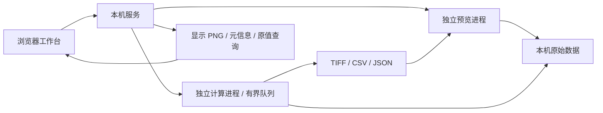

# Expertise Image Processor

本地专业图像与视频工作台。两个核心始终是 **视频数据预览** 与 **数据处理**。

当前版本为 `0.5.1`，默认使用 **本机 Web 工作台**。在导入、视频预览、ROI 编辑、处理及结果串联的基础上，提供独立 **分幅强度关联布局**：固定配准、完整序列基线、正负延迟 g² 系数图、固定中心帧的点 / ROI 曲线与导出。Python 读取、算法模块和计算进程保持独立。使用与数值定义见 [docs/SPLIT_CORRELATION_0_4_0.md](docs/SPLIT_CORRELATION_0_4_0.md)，完整目标规划见 [FRAMEWORK_PLAN.md](FRAMEWORK_PLAN.md)；CINE 支持范围见 [docs/CINE_0_3_1.md](docs/CINE_0_3_1.md)。

0.4.1 增加数据 / 结果双视窗、自定义结果名称、详细任务参数、LUT 曲线预设、可拖排和重复添加的执行模块，以及独立的 τ 扫描 / 固定 τ 空间图入口。使用和模块契约见 [docs/SPLIT_WORKFLOW_0_4_1.md](docs/SPLIT_WORKFLOW_0_4_1.md)。

0.5.0 将算法统一为跨布局共享的模块目录，取消分幅五段导航；所有模块均可新增、删除、复制、启停和排序。模块参数未完成时仍可定位原始帧，删除全源统计后不会继续扫描背景。新使用方式、类型规则和兼容边界见 [docs/UNIFIED_MODULES_0_5_0.md](docs/UNIFIED_MODULES_0_5_0.md)。长期原则写入 [AGENTS.md](AGENTS.md)。

0.5.1 将模块流程与参数设置拆为右侧并排两列，可分别水平展开、收起为窄标签和独立滚动；来源栏、右侧两列、双视窗与任务区之间均可拖动调整。列宽和展开状态随浏览器草稿和项目保存，支持一键重置。操作说明见 [docs/GUI_0_5_1.md](docs/GUI_0_5_1.md)。

## 启动

当前机器已准备项目虚拟环境，双击根目录的 **start.cmd** 即可启动服务并打开浏览器。地址为 **http://127.0.0.1:8765**。保持启动窗口运行，关闭窗口即停止服务；端口已被占用时，请直接打开地址或停止旧实例。

当前固定依赖支持 Python 3.12–3.14。Windows 下在项目目录执行：

```powershell
python -m venv .venv
.\.venv\Scripts\python.exe -m pip install -r requirements.txt
.\.venv\Scripts\python.exe run_web.py
```

本次开发环境为 Python 3.14.3；新依赖装入项目环境，复用了机器已有的 NumPy、Pillow 和 tifffile。重新部署按 requirements.txt 安装，不复制虚拟环境。Web 前端无需 Node.js、编译步骤、账号或联网素材。

需要指定端口或关闭浏览器自动打开时：`python run_web.py --port 8766 --no-browser`。Qt 兼容入口保留在 **start_desktop.cmd**，额外依赖见 requirements-desktop.txt；默认 Web 入口不依赖 PySide6。

## Web 架构

浏览器管理工作台交互和画布；本机 FastAPI 服务管理来源、显示缓存和任务；解码与算法分别使用独立 Python 进程。静态前端使用 HTML/CSS/JavaScript 模块，不引入额外构建框架。



服务仅监听 127.0.0.1；使用同源请求、工作台会话令牌与主机校验。文件通过本机目录选择器引用，不上传到云端。浏览器接收最长边 1800 像素的显示 PNG，原始高位深数组保留在后端；缩放坐标和原值查询仍对应原始像素。界面明确标记显示降采样。

## 当前可用功能

- PNG、JPEG、BMP、二维 TIFF 及受支持的 TIFF 页序列；图像目录序列使用自然排序，并由用户指定时间间隔。
- 常规视频流读取、播放、逐帧前进/后退、按真实时间戳定位。未知绝对索引明确显示为未知。
- Phantom `.cine` v0/v1 灰度读取：8 位、16 位容器及保存值为 10 位的 Packed10。利用文件偏移表按需读取，保留原始保存码值和逐帧时间；支持按帧号 / 时间切换定位、ROI 和原有处理链。采集源帧号与触发时间差另列；没有时间表时仍支持按帧定位。
- 保留支持格式的 uint16/浮点像素；原值查询、缩放、平移、窗宽映射、伽马、伪彩色。
- 每个输入来源保留自己的矩形 ROI；支持拖动、八方向缩放、整数坐标输入、键盘微调、撤销/重做、全幅/清除及原值统计。当前语义为 **完整图像处理后，裁剪输出区域**，因此滤波上下文不会因选区丢失。
- 输入/结果并排查看、视图同步，各自设置显示范围和色图，也可明确复制窗宽；标签使用离散调色板。
- 统一模块链，可添加、复制、停用、移除、拖动排序及修改独立参数；内置强度变换、均值 / 高斯滤波、阈值分割、固定强度曲线、校准、双幅配准、幅面选择、全源统计与二阶关联。所有布局复用同一目录和数值实现，连接须满足数据类型。
- 精确当前帧试算与正式处理共享同一数值实现；配置或位置变化后，试算结果标记过期。
- 图像/视频读取与算法执行放在独立进程；正式任务串行排队，支持取消及批量逐文件状态。
- 输出 TIFF 帧序列、CSV 统计和 JSON 运行记录；原文件不改写；未完成输出保留为 `.partial`。
- 保存和恢复来源、处理链、ROI、显示设置、处理范围及结果引用。正式结果根据 CSV 来源时间/帧映射同步预览；范围之外显示没有对应输出。
- 本地 Python 算法描述注册与执行；模型运行协议已预留。
- 正式结果可“作为下一阶段输入”；新输入使用裁剪后数组坐标，来源链保留上游运行记录及其哈希、父来源、原始 ROI 原点和时间映射。
- 导入文件与目录序列分别选择，坏文件逐项反馈；来源完整属性、筛选、多选和引用移除。深色三栏面板可收起，专注预览暂时隐藏侧栏、显示设置和任务区。
- 同一浏览器刷新可恢复处理草稿、每个来源的 ROI、显示、播放位置及面板设置；项目 JSON 用于长期保存和跨会话恢复。
- 分幅模式：中线与左右有效区编辑、固定平移建议、人工微调、镜像及显式亚像素插值；各路完整全源均值 / 方差 / 固定 RMS，LUT 校准和暗场偏置。
- 标准二阶互关联：窗口 W、时间步长 S、负 / 零 / 正延迟范围或列表；CPU 窗口试算与正式处理共用内核，CuPy / CUDA 可选。系数图按磁盘映射保存、二维切片预览，float64 / float32 精度可选。
- 固定中心的点 / ROI 曲线可独立计算；区分逐像素 g² 空间平均与区域总强度 g²。可导出曲线 CSV / PNG / SVG / JSON、系数图 TIFF、窗口 CSV 和运行 JSON；选定 τ 的序列可继续处理。

## 使用顺序

1. “导入数据”打开本机目录窗口。选择“文件”导入图像或视频，Ctrl / Shift 多选或全选；选择“目录序列”导入当前目录，时间间隔未知可留空。也可输入完整文件路径。混合导入保留成功项，并列出失败项供重试。“体验示例数据”生成明确标记的模拟 TIFF 与视频。
2. 在中央查看数据，使用时间轴/单帧按钮定位；CINE 默认按从 1 开始的文件帧号定位，可切换“时间”（相对文件首帧的秒数）。底栏显示实际帧位置和时间，不根据平均帧率猜测未知索引；CINE 另显示可为负数的采集源帧号及相对触发时刻的时间差。滚轮缩放，拖动平移。“矩形 ROI”开启选区，拖动内部移动、边角缩放，右侧输入精确坐标；ROI 模式下方向键微调，Shift + 方向键移动 10 像素，Ctrl + Z / Ctrl + Shift + Z 撤销/重做。Alt 或鼠标中键仍可平移视图。
3. 在右侧添加处理步骤，配置参数。“当前帧试算”始终使用当前帧与当前 ROI。
4. 检查输入与结果；显示控制只改变画面，不改变算法数值。
5. 选择当前帧、指定范围或全部数据，设置输出目录，点击“运行处理”。帧范围从 1 起，结束帧/时间均不包含。
6. 批处理时勾选“处理全部输入来源”。批量当前帧模式不支持；不同范围单位的数据不能混用指定范围。
7. 完成后在左侧“处理结果”打开输出；关联输入保持独立，并按来源位置同步结果。任务“详情”可下载各来源 CSV、首帧 TIFF 和运行 JSON，全部 TIFF 位于输出目录。显示设置展开后可调整窗宽、伽马与色图。
8. 继续处理时点击“结果作为下一阶段输入”。来源列表新增派生输入，上一阶段处理步骤清空，处理范围设为全部数据；添加新的算法步骤后试算或运行。在“属性 / 来源”查看上游记录。试算缓存不作为正式阶段输入。

结果的 TIFF 文件保存位深和 ROI 原点；视频解码的颜色转换会记录在来源描述。目录中的 `measurements.csv` 保存输出帧到源帧/时间的映射；0.3.1 新增 `source_frame_number`（CINE 采集源帧号）和 `trigger_time_seconds`（相对触发时刻的秒数），没有对应信息时留空。`run.json` 保存完整参数、算法/插件摘要、状态和来源属性指纹。

## 自定义算法

点击“接入算法”，选择 [examples/plugins/invert.json](examples/plugins/invert.json)，再把“示例：数值反相”加入处理链。源码为 [invert.py](examples/plugins/invert.py)。注册过程只读取描述，不在 UI 中导入插件代码。

插件类实现：

```python
class MyAlgorithm:
    def prepare(self, parameters, context):
        # 加载模型或准备可复用资源；每次任务只调用一次。
        pass

    def process(self, pixels, context):
        context.check_cancelled()
        # 返回同一空间尺寸的 YX / YXS NumPy 数组。
        return pixels.copy()

    def close(self):
        pass
```

参数描述支持整数、浮点、布尔和文本。描述包含插件标识、版本、入口、执行范围和输出类型；代码变化后须重新注册。参数和输入验证、取消检查以及输出语义都是契约的一部分。

通用处理链的插件执行器只接受逐帧、保留空间尺寸的算法。标签输出必须是二维非负整数/布尔数组。分幅模式使用独立的全序列统计 / 时序窗口执行器及模块契约，不能直接把逐帧插件作为关联估计器；扩展位置见专项说明。

专业模型可在外部插件 prepare 中加载、process 中推理。框架中的 `ModelSpec` / `ModelRuntime` 定义模型适配边界；尚未提供 ONNX 内置推理、GPU 调度、训练界面。插件代码与应用共享本机权限，进程隔离用于故障隔离，不是安全沙箱。

## 当前边界

- 支持格式以样例验证为边界；不支持任意 TIFF 多维/多 series、医学格式、三维查看或实时采集。
- CINE 当前支持灰度保存码值；不支持彩色/Bayer、CCI 压缩或需要从 Packed10 扩展至更高有效位深的变体。不隐式执行相机 LUT 线性化、黑白校正、翻转或伽马；相机处理后的画面可能不同，科学处理应明确采用保存码值还是另接校正算法。输出沿用 TIFF / CSV / JSON，不写回 CINE。
- 视频首个视频流作为输入，不处理音频；播放速率当前依据流元信息调度，定位和数据处理使用真实 PTS。
- 常规视频正式处理从流起点顺序解码，保证帧序号准确且内存有界；远距离范围处理还未加入索引加速。CINE 使用文件偏移和时间表定位范围起点，按需读帧；持久索引及时间表限制为 128 MiB，单帧编码数据限制为 256 MiB。缺少逐帧时间表的 CINE 仅支持当前帧或全部数据处理。
- reader 图像缓存预算为 128 MiB；Web 原值缓存最多 6 帧、目标 128 MiB，单个超大帧仍需独立足够内存。当前页面保留一个在途定位请求并合并拖动定位；后端最多接受 2 个在途预览请求。来源最多 64 项，待处理任务最多 32 项，任务历史最多 64 项。
- 任务取消在算法检查点生效；不可中断调用可能需要等待。没有通用暂停/恢复或强制停止按钮。
- 输出目前是 TIFF 序列和 CSV，不提供编码视频导出。
- 来源指纹基于路径、大小和修改时间，不是完整文件内容哈希。运行记录明确标注这一点。
- 项目保存绝对路径，加载支持最多 32 个输入来源；来源搬迁需修正路径。新 Web 字段保存每个来源的 ROI、显示、位置、来源链和界面设置，兼容旧项目。浏览器草稿需要本地存储可用且服务仍保留对应来源；不自动恢复执行中的任务，也不自动导入缺失数据。算法版本变化时要求重新添加步骤。
- 当前每个来源支持一个矩形 ROI；多 ROI、跨来源共享选区和浅色主题尚未实施，待用户确定管理和布局方向。
- 一次服务对应一个共享工作区，多标签页共用来源和任务；尚未提供多人会话或局域网服务。结果时间匹配目前扫描 CSV，超长输出序列需后续索引加速。
- 实测速率仅对应验证数据与配置，尚无通用实时播放或处理吞吐承诺。
- 分幅 0.4.0 自动配准仅估计固定平移，需检查后接受；仿射 / 非刚性及模型配准待实现。普通视频没有精确帧索引时，需先导出灰度序列；CINE 码值与光强的线性关系仍需实验确认。
- 分幅结果使用 `.npy` 磁盘映射，尚不压缩 / 分片；完整基线首次读取全部输入帧。一个分析 ROI、最多 32 个点；时间—延迟总览、分数帧延迟、断点续算及真实 CUDA 硬件验证待后续实施。

## 验证

```powershell
.\.venv\Scripts\python.exe -m pip install -r requirements-dev.txt
.\.venv\Scripts\python.exe -m pytest -q
# 另一个窗口先运行 run_web.py --no-browser
.\.venv\Scripts\python.exe tools\smoke_web.py
# 自建临时服务、测试数据及独立浏览器，不影响当前工作台
.\.venv\Scripts\python.exe tools\smoke_refinement.py
# 使用真实 Packed10 CINE，自建独立服务，原文件只读
.\.venv\Scripts\python.exe tools\smoke_cine.py --source "F:\Data-test\Test1\22741_1_4.cine"
# 分幅模式的独立浏览器流程
.\.venv\Scripts\python.exe tools\smoke_split.py
# 全部 CINE 输入帧基线、独立解码参考、正负延迟图 / 曲线
.\.venv\Scripts\python.exe tools\smoke_split_cine.py --source "F:\Data-test\Test1\22741_1_4.cine"
```

自动测试覆盖数值内核和 Web 接口，包括高位深、显示与数据隔离、真实时间、插件、试算 / 正式一致、ROI、取消、串联、项目恢复及 CINE 解码。分幅专项另核对双向窗口边界、完整基线与直接 g² 等价、联合有效样本、LUT 先于插值、配准方向、两种 ROI 估计、内存预算、保存精度、导出及 GPU 启动失败时的 Auto 回退。

浏览器验证脚本使用独立无头浏览器，Windows 默认使用已安装的 Edge；不读取用户浏览器资料。验证视频定位、ROI、试算过期、显示调节、正式导出、CSV 下载、项目恢复、外部插件，以及 1440×960 / 1024×768 布局。首次运行应从空工作区开始，示例文件自动由界面生成。截图输出到被 Git 忽略的 `.test-output/web-ui`。Qt 兼容流程仍可使用 tools/smoke_ui.py。

`smoke_refinement.py` 在独立的临时工作目录验证坏文件混合导入、目录间隔、末帧停止、快速定位/切换来源、ROI 移动/缩放/数值编辑/撤销、每个来源选区、原值统计、刷新草稿、独立显示、结果晋级及小窗口专注预览。截图和测试数据保存在 `.test-output/refinement-*`。

`smoke_cine.py` 已用用户提供的 15.2 GB、370,801 帧、256×128 Packed10 CINE 验证独立参考解码、首帧/触发帧/末帧、精确前后步进、时间定位往返、ROI 试算与 TIFF/CSV 导出、正式结果映射、刷新定位恢复及两种窗口宽度。测试输出仅写入 `.test-output/cine-*`；未修改原文件。

`smoke_split_workflow.py` 核对 0.4.1 双视窗、ROI、模块拖排 / 复制、独立任务入口、命名、导出与刷新恢复。`smoke_split.py` 是当前浏览器回归的兼容入口，核对分幅、曲线、ROI 编辑、时间 / 延迟导航、刷新恢复、导出及来源显示，并检查 1440×960 / 1100×760 布局。`smoke_split_cine.py` 对全部 370,801 帧建立完整基线，独立解码 194 帧核对 6 个窗口 × 9 个延迟的 16×16 图及曲线；首次基线实测约 377 秒，后续同一标定复用缓存。测试矩形不能代替实验标定；详情见专项说明。

维护时可用 `--workspace <目录>` 指定工作目录，`--restore-session <本地快照.json>` 恢复已结束的来源/任务记录。维护快照保留会话令牌，仅用于本机维护，不能替代项目文件；原值帧缓存需重新定位或试算后恢复。

## Git

开发在本地 `main` 分支进行。规划与代码按阶段提交；当前没有配置远程仓库，也未推送。

由于 Codex 沙箱账户与当前目录所有者不同，沙箱中的 Git 操作使用当前命令限定的 `safe.directory` 参数，不修改全局 Git 配置。正常用户账户可直接运行 `git status`、`git log` 等命令。

## 后续阶段

分幅强度关联的 CPU 基线及专用工作台已在 0.4.0 实现。下一阶段结合实际配准误差和运行成本，验证仿射 / 特征方法、GPU 和压缩分块存储；完整方向见 [专项规划](docs/SPLIT_INTENSITY_CORRELATION_PLAN.md)。

结合实际数据继续补齐时序执行器、多轴数据适配、模型推理运行时及性能基线。每项扩展都接回“预览 → 处理 → 对比 → 导出”的同一流程。
