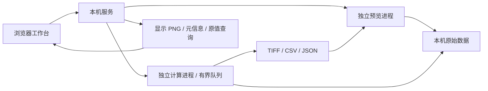

# Expertise Image Processor

本地专业图像与视频工作台。两个核心始终是 **视频数据预览** 与 **数据处理**。

当前版本为 `0.2.0`，默认使用 **本机 Web 工作台**。前端已从 Qt 迁移到浏览器，Python 读取、算法插件和计算进程保持独立。已实现打开、预览、选区、配置、试算、正式处理、对比及导出的贯通流程。完整规划见 [FRAMEWORK_PLAN.md](FRAMEWORK_PLAN.md)。

## 启动

当前机器已准备项目虚拟环境，双击根目录的 **start.cmd** 即可启动服务并打开浏览器。地址为 **http://127.0.0.1:8765**。保持启动窗口运行，关闭窗口即停止服务；端口已被占用时，请直接打开地址或停止旧实例。

当前固定依赖支持 Python 3.12–3.14。Windows 下在项目目录执行：

```powershell
python -m venv .venv
.\.venv\Scripts\python.exe -m pip install -r requirements.txt
.\.venv\Scripts\python.exe run_web.py
```

本次开发环境为 Python 3.14.3；新依赖装入项目环境，复用了机器已有的 NumPy、Pillow 和 tifffile。重新部署按 requirements.txt 安装，不复制虚拟环境。Web 前端无需 Node.js、编译步骤、账号或联网素材。

需要指定端口或关闭浏览器自动打开时：`python run_web.py --port 8766 --no-browser`。Qt 兼容入口保留在 **start_desktop.cmd**，额外依赖见 requirements-desktop.txt；默认 Web 入口不依赖 PySide6。

## Web 架构

浏览器管理工作台交互和画布；本机 FastAPI 服务管理来源、显示缓存和任务；解码与算法分别使用独立 Python 进程。静态前端使用 HTML/CSS/JavaScript 模块，不引入额外构建框架。



服务仅监听 127.0.0.1；使用同源请求、工作台会话令牌与主机校验。文件通过本机目录选择器引用，不上传到云端。浏览器接收最长边 1800 像素的显示 PNG，原始高位深数组保留在后端；缩放坐标和原值查询仍对应原始像素。界面明确标记显示降采样。

## 当前可用功能

- PNG、JPEG、BMP、二维 TIFF 及受支持的 TIFF 页序列；图像目录序列使用自然排序，并由用户指定时间间隔。
- 常规视频流读取、播放、逐帧前进/后退、按真实时间戳定位。未知绝对索引明确显示为未知。
- 保留支持格式的 uint16/浮点像素；原值查询、缩放、平移、窗宽映射、伽马、伪彩色。
- 矩形 ROI；当前语义为 **完整图像处理后，裁剪输出区域**，因此滤波上下文不会因选区丢失。
- 输入/结果并排查看、视图同步；标签使用离散调色板。
- 顺序处理链，可添加、停用、移除、排序及修改参数；内置强度变换、均值滤波和阈值分割。
- 精确当前帧试算与正式处理共享同一数值实现；配置或位置变化后，试算结果标记过期。
- 图像/视频读取与算法执行放在独立进程；正式任务串行排队，支持取消及批量逐文件状态。
- 输出 TIFF 帧序列、CSV 统计和 JSON 运行记录；原文件不改写；未完成输出保留为 `.partial`。
- 保存和恢复来源、处理链、ROI、显示设置、处理范围及结果引用。正式结果根据 CSV 来源时间/帧映射同步预览；范围之外显示没有对应输出。
- 本地 Python 算法描述注册与执行；模型运行协议已预留。

## 使用顺序

1. “导入数据”打开本机目录窗口，选择图像或视频。单击目录进入；Ctrl + 单击多选文件；不选择文件时点击“打开数据 / 当前目录”将目录作为图像序列。时间间隔未知时可留空。“体验示例数据”生成并打开标记为模拟数据的实际 TIFF 与视频。
2. 在中央查看数据，使用时间轴/单帧按钮定位；滚轮缩放，拖动平移。“矩形 ROI”开启选区。
3. 在右侧添加处理步骤，配置参数。“当前帧试算”始终使用当前帧与当前 ROI。
4. 检查输入与结果；显示控制只改变画面，不改变算法数值。
5. 选择当前帧、指定范围或全部数据，设置输出目录，点击“运行处理”。帧范围从 1 起，结束帧/时间均不包含。
6. 批处理时勾选“处理全部输入来源”。批量当前帧模式不支持；不同范围单位的数据不能混用指定范围。
7. 完成后在左侧“处理结果”打开输出；关联输入保持独立，并按来源位置同步结果。任务“详情”可下载各来源 CSV、首帧 TIFF 和运行 JSON，全部 TIFF 位于输出目录。显示设置展开后可调整窗宽、伽马与色图。

结果的 TIFF 文件保存位深和 ROI 原点；视频解码的颜色转换会记录在来源描述。目录中的 `measurements.csv` 保存输出帧到源帧/时间的映射；`run.json` 保存完整参数、算法/插件摘要、状态和来源属性指纹。

## 自定义算法

点击“接入算法”，选择 [examples/plugins/invert.json](examples/plugins/invert.json)，再把“示例：数值反相”加入处理链。源码为 [invert.py](examples/plugins/invert.py)。注册过程只读取描述，不在 UI 中导入插件代码。

插件类实现：

```python
class MyAlgorithm:
    def prepare(self, parameters, context):
        # 加载模型或准备可复用资源；每次任务只调用一次。
        pass

    def process(self, pixels, context):
        context.check_cancelled()
        # 返回同一空间尺寸的 YX / YXS NumPy 数组。
        return pixels.copy()

    def close(self):
        pass
```

参数描述支持整数、浮点、布尔和文本。描述包含插件标识、版本、入口、执行范围和输出类型；代码变化后须重新注册。参数和输入验证、取消检查以及输出语义都是契约的一部分。

当前执行器只接受逐帧、保留空间尺寸的算法。标签输出必须是二维非负整数/布尔数组。时序窗口、全序列状态、几何变换及专用 Python 环境执行器将在后续阶段接入，不伪装成已实现的能力。

专业模型可在外部插件 prepare 中加载、process 中推理。框架中的 `ModelSpec` / `ModelRuntime` 定义模型适配边界；尚未提供 ONNX 内置推理、GPU 调度、训练界面。插件代码与应用共享本机权限，进程隔离用于故障隔离，不是安全沙箱。

## 当前边界

- 支持格式以样例验证为边界；不支持任意 TIFF 多维/多 series、医学格式、三维查看或实时采集。
- 视频首个视频流作为输入，不处理音频；播放速率当前依据流元信息调度，定位和数据处理使用真实 PTS。
- 正式视频处理从流起点顺序解码，保证帧序号准确且内存有界；远距离范围处理还未加入索引加速。
- reader 图像缓存预算为 128 MiB；Web 原值缓存最多 6 帧、目标 128 MiB，单个超大帧仍需独立足够内存。当前页面保留一个在途定位请求并合并拖动定位；后端最多接受 2 个在途预览请求。来源最多 64 项，待处理任务最多 32 项，任务历史最多 64 项。
- 任务取消在算法检查点生效；不可中断调用可能需要等待。没有通用暂停/恢复或强制停止按钮。
- 输出目前是 TIFF 序列和 CSV，不提供编码视频导出。
- 来源指纹基于路径、大小和修改时间，不是完整文件内容哈希。运行记录明确标注这一点。
- 项目保存绝对路径，加载支持最多 32 个输入来源；来源搬迁需修正路径。Web 字段保存处理范围、批量设置和显示配置；兼容旧项目的来源与算法结构。当前不恢复播放位置和任务队列。刷新页面不会自动恢复未保存的处理参数。
- 一次服务对应一个共享工作区，多标签页共用来源和任务；尚未提供多人会话或局域网服务。结果时间匹配目前扫描 CSV，超长输出序列需后续索引加速。
- 未测量用户实际数据与硬件，尚无通用实时播放或处理吞吐承诺。

## 验证

```powershell
.\.venv\Scripts\python.exe -m pip install -r requirements-dev.txt
.\.venv\Scripts\python.exe -m pytest -q
# 另一个窗口先运行 run_web.py --no-browser
.\.venv\Scripts\python.exe tools\smoke_web.py
```

当前 30 项测试覆盖数值内核和 Web 接口，包括高位深、显示与数据隔离、真实视频时间戳、重新打开后逐帧前进、插件、试算与正式输出一致、ROI、取消、逐文件失败、结果映射和项目恢复。

浏览器验证脚本使用独立无头浏览器，Windows 默认使用已安装的 Edge；不读取用户浏览器资料。验证视频定位、ROI、试算过期、显示调节、正式导出、CSV 下载、项目恢复、外部插件，以及 1440×960 / 1024×768 布局。首次运行应从空工作区开始，示例文件自动由界面生成。截图输出到被 Git 忽略的 `.test-output/web-ui`。Qt 兼容流程仍可使用 tools/smoke_ui.py。

## Git

开发在本地 `main` 分支进行。规划与代码按阶段提交；当前没有配置远程仓库，也未推送。

由于 Codex 沙箱账户与当前目录所有者不同，沙箱中的 Git 操作使用当前命令限定的 `safe.directory` 参数，不修改全局 Git 配置。正常用户账户可直接运行 `git status`、`git log` 等命令。

## 后续阶段

接下来优先结合实际数据补齐时序执行器、明确多维数据适配、模型推理运行时及性能基线。每项扩展都接回“预览 → 处理 → 对比 → 导出”的同一流程。
