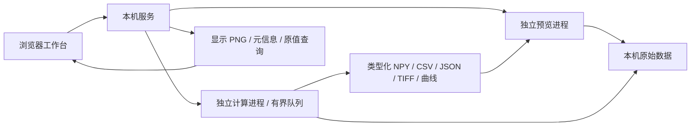

# Expertise Image Processor

本地专业图像与视频工作台。两个核心始终是 **视频数据预览** 与 **数据处理**。

当前版本为 `0.7.3`，默认使用 **本机 Web 模块工作台**。模块流程是中心工作区，模块库按 **中间 / 算法 / 修饰** 三类组织；检查器分为参数、公式和输入输出，工作台运行设置独立。数据与结果使用独立视窗，支持页面内浮窗和停靠。27 个模块的公式、参数与边界见 [模块清单](docs/MODULE_INVENTORY_CURRENT.md)，操作与迁移见 [工作台说明](docs/MODULE_WORKBENCH_0_7_0.md)，本轮更新见 [0.7.3 自动上下界](docs/DISTRIBUTION_BOUNDS_0_7_3.md)，直方图修复见 [0.7.2](docs/DISTRIBUTION_FIX_0_7_2.md)，前次交互更新见 [0.7.1](docs/GUI_FIXES_0_7_1.md)。原有 [空间 / 时间契约](docs/MODULE_CONTRACTS_0_6_0.md) 继续适用；重做规格见 [GUI 规划](docs/GUI_MODULE_WORKBENCH_REDESIGN_PLAN.md)，完整目标见 [FRAMEWORK_PLAN.md](FRAMEWORK_PLAN.md)。

0.7.0 拆分 ROI 裁剪与区域归约、序列统计与固定尺度归一，提供固定延迟图 / 延迟扫描两个明确算法入口。新增点、线、按轴截面、分布、灰度 / 颜色转换、参数传递及 **数据截流导出**：获取直接前序输出，可导出到数据预览、类型化数据集、NPY、适用的 CSV / TIFF，主流程继续执行。旧项目迁移建立新副本，历史结果原义保留。

0.6.0 新增时间裁剪、空间 ROI / 归约、时间取间隔、加窗和合帧模块。ROI 可保留像素矩阵或取均值、总和、分位值；归约后不能再接空间算法。W、τ 和步长按关联模块收到的编辑后样本计数，并保留真实时间差。统计针对本节点直接上游的完整序列。旧结果保留旧定义；新 Web 流程使用契约3。

0.4.1 增加数据 / 结果双视窗、自定义结果名称、详细任务参数、LUT 曲线预设、可拖排和重复添加的执行模块，以及独立的 τ 扫描 / 固定 τ 空间图入口。使用和模块契约见 [docs/SPLIT_WORKFLOW_0_4_1.md](docs/SPLIT_WORKFLOW_0_4_1.md)。

0.5.0 将算法统一为跨布局共享的模块目录，取消分幅五段导航；所有模块均可新增、删除、复制、启停和排序。模块参数未完成时仍可定位原始帧，删除全源统计后不会继续扫描背景。新使用方式、类型规则和兼容边界见 [docs/UNIFIED_MODULES_0_5_0.md](docs/UNIFIED_MODULES_0_5_0.md)。长期原则写入 [AGENTS.md](AGENTS.md)。

0.5.1 将模块流程与参数设置拆为右侧并排两列，可分别水平展开、收起为窄标签和独立滚动；来源栏、右侧两列、双视窗与任务区之间均可拖动调整。列宽和展开状态随浏览器草稿和项目保存，支持一键重置。操作说明见 [docs/GUI_0_5_1.md](docs/GUI_0_5_1.md)。

0.5.2 将模式移到模块流程列，作为模块与参数预设；两种预设共用数据 / 结果画布、播放循环及帧读取队列。单视窗铺满中央区域，普通播放不再触发分幅几何计算；关联中心帧与预览位置分开设置。操作与兼容规则见 [docs/SHARED_PREVIEW_0_5_2.md](docs/SHARED_PREVIEW_0_5_2.md)。

## 启动

当前机器已准备项目虚拟环境，双击根目录的 **start.cmd** 即可启动服务并打开浏览器。地址为 **http://127.0.0.1:8765**。保持启动窗口运行，关闭窗口即停止服务；端口已被占用时，请直接打开地址或停止旧实例。

当前固定依赖支持 Python 3.12–3.14。Windows 下在项目目录执行：

```powershell
python -m venv .venv
.\.venv\Scripts\python.exe -m pip install -r requirements.txt
.\.venv\Scripts\python.exe run_web.py
```

本次开发环境为 Python 3.14.3；新依赖装入项目环境，复用了机器已有的 NumPy、Pillow 和 tifffile。重新部署按 requirements.txt 安装，不复制虚拟环境。Web 前端无需 Node.js、编译步骤、账号或联网素材。

需要指定端口或关闭浏览器自动打开时：`python run_web.py --port 8766 --no-browser`。Qt 兼容入口保留在 **start_desktop.cmd**，额外依赖见 requirements-desktop.txt；默认 Web 入口不依赖 PySide6。

## Web 架构

浏览器管理工作台交互和画布；本机 FastAPI 服务管理来源、显示缓存和任务；解码与算法分别使用独立 Python 进程。静态前端使用 HTML/CSS/JavaScript 模块，不引入额外构建框架。



服务仅监听 127.0.0.1；使用同源请求、工作台会话令牌与主机校验。文件通过本机目录选择器引用，不上传到云端。浏览器接收最长边 1800 像素的显示 PNG，原始高位深数组保留在后端；缩放坐标和原值查询仍对应原始像素。界面明确标记显示降采样。

## 当前可用功能

- PNG、JPEG、BMP、二维 TIFF 及受支持的 TIFF 页序列；图像目录序列使用自然排序，并由用户指定时间间隔。
- 常规视频流读取、播放、逐帧前进/后退、按真实时间戳定位。未知绝对索引明确显示为未知。
- Phantom `.cine` v0/v1 灰度读取：8 位、16 位容器及保存值为 10 位的 Packed10。利用文件偏移表按需读取，保留原始保存码值和逐帧时间；支持按帧号 / 时间切换定位、ROI 和原有处理链。采集源帧号与触发时间差另列；没有时间表时仍支持按帧定位。
- 保留支持格式的 uint16/浮点像素；原值查询、缩放、平移、窗宽映射、伽马、伪彩色。
- ROI 归属具体裁剪实例；支持输入画布选区、拖动 / 缩放及精确整数坐标。区域均值 / 总和 / 分位值在独立“区域归约”模块完成；排列位置决定真实运算上下文。
- 输入/结果并排查看、视图同步，各自设置显示范围和色图，也可明确复制窗宽；标签使用离散调色板。
- 统一模块链，可添加、复制、停用、移除、拖动 / 键盘排序、撤销 / 重做；实例独立设置参数。三类目录、图标和公式帮助查找与理解；形状编译同时检查轴、尺寸、样本数及强度 / 标签 / g² 含义。
- 修饰模块支持旁路采集或明确替换主路，点 / 直线 / 截面 / 分布保留真实轴；数据截流可发布到数据预览。受支持的数值参数可引用前序参数或统计端口，运行前校验方向、类型和范围，运行记录保存解析值及来源。
- 每步可显式检查输入或输出；检查使用独立、可取消的进程，不进入任务队列。试算与正式处理使用同一实现；支持运行到当前模块。原始播放不执行模块，不完整流程不会阻断定位。
- 图像/视频读取与算法执行放在独立进程；正式任务串行排队，支持取消及批量逐文件状态。
- 新流程保存完整类型化 NPY、数值 / 统计 CSV、逐样本映射和 JSON 运行记录；矩阵附首幅 TIFF，标量 / 向量附 PNG / SVG。旧 TIFF 序列和关联结果继续读取。原文件不改写；未完成输出保留为 `.partial`。
- 保存和恢复来源、模块实例、显示、面板布局和结果引用。结果使用独立样本定位与播放；合帧不冒称某个采集帧，贡献来源随记录保存。
- 本地 Python 算法描述注册与执行；模型运行协议已预留。
- 正式结果可“作为下一阶段输入”；新输入使用裁剪后数组坐标，来源链保留上游运行记录及其哈希、父来源、原始 ROI 原点和时间映射。
- 导入文件与目录序列分别选择，坏文件逐项反馈；来源完整属性、筛选、多选和引用移除。模块流程、检查器、数据和结果窗口可按工作需求调整，固定运行条保持可达。
- 同一浏览器刷新可恢复处理草稿、每个来源的 ROI、显示、播放位置及面板设置；项目 JSON 用于长期保存和跨会话恢复。
- 分幅预设：中线与左右有效区编辑、固定平移建议、人工微调、镜像及显式亚像素插值；本节点直接上游序列的均值 / 方差 / 固定 RMS，LUT 校准和暗场偏置。
- 标准二阶互关联：窗口 W、时间步长 S、负 / 零 / 正延迟范围或列表；CPU 窗口试算与正式处理共用内核，CuPy / CUDA 可选。系数图按磁盘映射保存、二维切片预览，float64 / float32 精度可选。
- 固定中心的单像素 / ROI 曲线独立计算；区域均值 / 总和放在关联之前，像素 g² 的空间平均放在关联之后，结果记录区分两者。信号和矩阵的正式输出均可继续处理。

## 使用顺序

1. “导入数据”打开本机目录窗口。选择“文件”导入图像或视频，Ctrl / Shift 多选或全选；选择“目录序列”导入当前目录，时间间隔未知可留空。也可输入完整文件路径。混合导入保留成功项，并列出失败项供重试。“体验示例数据”生成明确标记的模拟 TIFF 与视频。
2. 在中央定位、播放原始数据；底栏显示实际帧和真实时间。滚轮缩放，拖动平移。原始播放与流程计算分开。
3. 起点“时间范围”设置一次范围；从模块库添加 ROI 裁剪、时间编辑及算法。需要均值、总和或分位值时添加“区域归约”；需要中途观察或保存时添加“数据截流导出”。选中实例，在参数页编辑，在公式和输入输出页核对定义及连接。
4. 检查输入与结果；显示控制只改变画面，不改变算法数值。
5. 时间裁剪的样本号从 1 起、尾样本包含；真实时间范围为起点包含 / 终点不包含。每步“检查样本”用于阶段检查；“流程试算”使用选定的编辑后输出样本，固定 τ 试算中心在关联实例设置。选择输出目录后正式运行。
6. 批处理勾选“处理全部输入来源”；各来源分别校验模块形状和范围。
7. 完成后在“处理结果”选择最终结果或附加输出；矩阵按输出样本播放，信号使用对应的时间 / 延迟 / 位置轴。导出提供完整数值、样本映射和记录；截流导出到数据预览的正式结果还会出现在来源列表。
8. 继续处理时点击“结果作为下一阶段输入”。来源列表新增派生输入，上一阶段处理步骤清空，处理范围设为全部数据；添加新的算法步骤后试算或运行。在“属性 / 来源”查看上游记录。试算缓存不作为正式阶段输入。

结果的 TIFF 文件保存位深和 ROI 原点；视频解码的颜色转换会记录在来源描述。目录中的 `measurements.csv` 保存输出帧到源帧/时间的映射；0.3.1 新增 `source_frame_number`（CINE 采集源帧号）和 `trigger_time_seconds`（相对触发时刻的秒数），没有对应信息时留空。`run.json` 保存完整参数、算法/插件摘要、状态和来源属性指纹。

## 自定义算法

从模块库的自定义模块入口选择 [examples/plugins/invert.json](examples/plugins/invert.json)，再把“示例：数值反相”加入处理链。源码为 [invert.py](examples/plugins/invert.py)。示例包含分类、图标、公式和符号说明；注册过程只读取描述，不在 UI 中导入插件代码。

插件类实现：

```python
class MyAlgorithm:
    def prepare(self, parameters, context):
        # 加载模型或准备可复用资源；每次任务只调用一次。
        pass

    def process(self, pixels, context):
        context.check_cancelled()
        # 返回同一空间尺寸的 YX / YXS NumPy 数组。
        return pixels.copy()

    def close(self):
        pass
```

参数描述支持整数、浮点、布尔和文本。描述包含插件标识、版本、入口、执行范围和输出类型，可选 category、icon 和 documentation.formula；未提供公式时明确显示缺失。描述或代码变化后须重新注册。参数和输入验证、取消检查以及输出语义都是契约的一部分。

插件当前声明逐帧、保留空间尺寸的 YX / YXC 输入，标签输出为二维非负整数 / 布尔数组；输出 dtype 按实际运行保留。两个预设使用同一契约和执行器；未声明支持的标量、时间窗和形状变换明确拒绝。不能直接把逐帧插件当作时序关联估计器。

专业模型可在外部插件 prepare 中加载、process 中推理。框架中的 `ModelSpec` / `ModelRuntime` 定义模型适配边界；尚未提供 ONNX 内置推理、GPU 调度、训练界面。插件代码与应用共享本机权限，进程隔离用于故障隔离，不是安全沙箱。

## 当前边界

- 支持格式以样例验证为边界；不支持任意 TIFF 多维/多 series、医学格式、三维查看或实时采集。
- CINE 当前支持灰度保存码值；不支持彩色/Bayer、CCI 压缩或需要从 Packed10 扩展至更高有效位深的变体。不隐式执行相机 LUT 线性化、黑白校正、翻转或伽马；相机处理后的画面可能不同，科学处理应明确采用保存码值还是另接校正算法。输出沿用 TIFF / CSV / JSON，不写回 CINE。
- 视频首个视频流作为输入，不处理音频；播放速率当前依据流元信息调度，定位和数据处理使用真实 PTS。
- 常规视频正式处理从流起点顺序解码，保证帧序号准确且内存有界；远距离范围处理还未加入索引加速。CINE 使用文件偏移和时间表定位范围起点，按需读帧；持久索引及时间表限制为 128 MiB，单帧编码数据限制为 256 MiB。缺少逐帧时间表的 CINE 可按样本裁剪和抽样，真实时间裁剪不可用。
- reader 图像缓存预算为 128 MiB；Web 原值缓存最多 6 帧、目标 128 MiB，单个超大帧仍需独立足够内存。当前页面保留一个在途定位请求并合并拖动定位；后端最多接受 2 个在途预览请求。来源最多 64 项，待处理任务最多 32 项，任务历史最多 64 项。
- 任务取消在算法检查点生效；不可中断调用可能需要等待。没有通用暂停/恢复或强制停止按钮。
- 新模块流程完整输出为 NPY、CSV 和 JSON；矩阵附首幅 TIFF，信号附 PNG / SVG。旧流程的 TIFF 序列导出保留；不提供编码视频导出。
- 来源指纹基于路径、大小和修改时间，不是完整文件内容哈希。运行记录明确标注这一点。
- 项目保存绝对路径，加载支持最多 32 个输入来源；来源搬迁需修正路径。新 Web 字段保存每个来源的 ROI、显示、位置、来源链和界面设置，兼容旧项目。浏览器草稿需要本地存储可用且服务仍保留对应来源；不自动恢复执行中的任务，也不自动导入缺失数据。算法版本变化时要求重新添加步骤。
- 空间 ROI 可添加多个串联实例，每个相对其直接上游坐标；并行多区域对比需分别运行。跨来源共享选区和浅色主题尚未实施。
- 一次服务对应一个共享工作区，多标签页共用来源和任务；尚未提供多人会话或局域网服务。结果时间匹配目前扫描 CSV，超长输出序列需后续索引加速。
- 实测速率仅对应验证数据与配置，尚无通用实时播放或处理吞吐承诺。
- 自动配准仅估计固定平移，需检查后接受；仿射 / 非刚性及模型配准待实现。普通视频在任务中按实际解码建立临时索引，灰度配准不能接彩色；CINE 码值与光强的线性关系仍需实验确认。
- 结果使用 `.npy` 磁盘映射，尚不压缩 / 分片；统计读取本节点上游的完整序列。点信号使用明确的点提取模块，多点可重复添加旁路实例。时间—延迟总览、分数帧延迟、断点续算及真实 CUDA 硬件验证待后续实施。

## 验证

```powershell
.\.venv\Scripts\python.exe -m pip install -r requirements-dev.txt
.\.venv\Scripts\python.exe -m pytest -q
# 0.7.0 当前工作台：隔离服务、真实浏览器、截流数值及大小窗口
.\.venv\Scripts\python.exe tools\smoke_workbench.py
# 0.7.1：真实像素、结果恢复、前缀运行、日志与任务运行时的画布工具
.\.venv\Scripts\python.exe tools\smoke_gui_fixes.py
# 另一个窗口先运行 run_web.py --no-browser
.\.venv\Scripts\python.exe tools\smoke_web.py
# 自建临时服务、测试数据及独立浏览器，不影响当前工作台
.\.venv\Scripts\python.exe tools\smoke_refinement.py
# 使用真实 Packed10 CINE，自建独立服务，原文件只读
.\.venv\Scripts\python.exe tools\smoke_cine.py --source "F:\Data-test\Test1\22741_1_4.cine"
# 分幅模式的独立浏览器流程
.\.venv\Scripts\python.exe tools\smoke_split.py
# 全部 CINE 输入帧基线、独立解码参考、正负延迟图 / 曲线
.\.venv\Scripts\python.exe tools\smoke_split_cine.py --source "F:\Data-test\Test1\22741_1_4.cine"
# 0.6.0 空间 / 时间模块、真实形状、实例 ROI 与两套预设
.\.venv\Scripts\python.exe tools\smoke_axis_modules.py
# 编辑后 CINE 统计、逐像素图与正负延迟区域信号
.\.venv\Scripts\python.exe tools\smoke_axis_cine.py --source "F:\Data-test\Test1\22741_1_4.cine"
```

自动测试覆盖数值内核和 Web 接口，包括高位深、显示与数据隔离、真实时间、插件、试算 / 正式一致、ROI、取消、串联、项目恢复及 CINE 解码。分幅专项另核对双向窗口边界、完整基线与直接 g² 等价、联合有效样本、LUT 先于插值、配准方向、两种 ROI 估计、内存预算、保存精度、导出及 GPU 启动失败时的 Auto 回退。

浏览器验证脚本使用独立无头浏览器，Windows 默认使用已安装的 Edge；不读取用户浏览器资料。验证视频定位、ROI、试算过期、显示调节、正式导出、CSV 下载、项目恢复、外部插件，以及 1440×960 / 1024×768 布局。首次运行应从空工作区开始，示例文件自动由界面生成。截图输出到被 Git 忽略的 `.test-output/web-ui`。Qt 兼容流程仍可使用 tools/smoke_ui.py。

`smoke_refinement.py` 在独立的临时工作目录验证坏文件混合导入、目录间隔、末帧停止、快速定位/切换来源、ROI 移动/缩放/数值编辑/撤销、每个来源选区、原值统计、刷新草稿、独立显示、结果晋级及小窗口专注预览。截图和测试数据保存在 `.test-output/refinement-*`。

`smoke_cine.py` 已用用户提供的 15.2 GB、370,801 帧、256×128 Packed10 CINE 验证独立参考解码、首帧/触发帧/末帧、精确前后步进、时间定位往返、ROI 试算与 TIFF/CSV 导出、正式结果映射、刷新定位恢复及两种窗口宽度。测试输出仅写入 `.test-output/cine-*`；未修改原文件。

`smoke_split_workflow.py` 核对 0.4.1 双视窗、ROI、模块拖排 / 复制、独立任务入口、命名、导出与刷新恢复。`smoke_split.py` 是旧界面浏览器回归的兼容入口，核对分幅、曲线、ROI 编辑、时间 / 延迟导航、刷新恢复、导出及来源显示，并检查 1440×960 / 1100×760 布局。`smoke_split_cine.py` 对全部 370,801 帧建立完整基线，独立解码 194 帧核对 6 个窗口 × 9 个延迟的 16×16 图及曲线；首次基线实测约 377 秒，后续同一标定复用缓存。测试矩形不能代替实验标定；详情见专项说明。

0.7.0 当前界面回归使用 `smoke_workbench.py`；`smoke_axis_modules.py` 等旧界面脚本保留用于历史协议，不能用来验收新布局。`smoke_axis_cine.py` 对选定201帧的矩阵和区域信号分别直接套用标准 g² 公式，核对共享内核的输出与真实时间差。

维护时可用 `--workspace <目录>` 指定工作目录，`--restore-session <本地快照.json>` 恢复已结束的来源/任务记录。维护快照保留会话令牌，仅用于本机维护，不能替代项目文件；原值帧缓存需重新定位或试算后恢复。

## 算法参考

[FROM_LIFECALOT.md](FROM_LIFECALOT.md) 汇总旧 LifeCalor 工具箱的 40 组算法与实验参考，沿用当前模块清单格式，列出公式、参数、输入输出、源码定位和迁移边界，供后续选择接入。参考条目尚未注册到本程序。

## Git

开发在本地 `codex/` 前缀分支进行。规划与代码按阶段提交；当前没有配置远程仓库，也未推送。

由于 Codex 沙箱账户与当前目录所有者不同，沙箱中的 Git 操作使用当前命令限定的 `safe.directory` 参数，不修改全局 Git 配置。正常用户账户可直接运行 `git status`、`git log` 等命令。

## 后续阶段

分幅强度关联的 CPU 基线及专用工作台已在 0.4.0 实现。下一阶段结合实际配准误差和运行成本，验证仿射 / 特征方法、GPU 和压缩分块存储；完整方向见 [专项规划](docs/SPLIT_INTENSITY_CORRELATION_PLAN.md)。

结合实际数据继续补齐时序执行器、多轴数据适配、模型推理运行时及性能基线。每项扩展都接回“预览 → 处理 → 对比 → 导出”的同一流程。
