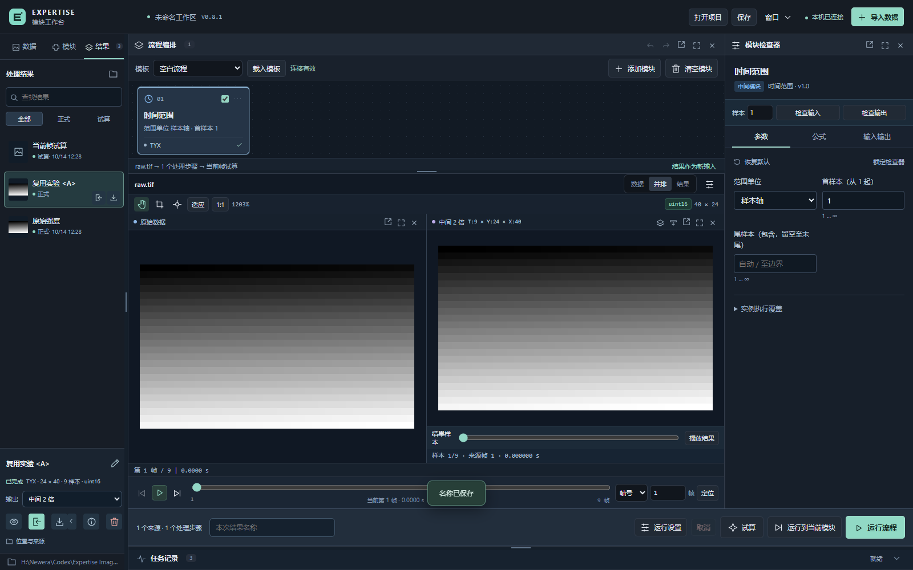

# Expertise Image Processor

**0.8.1 · 本机 Web 工作台 · Python 3.12–3.14**

面向科研数据的图像与视频工作台，将 **数据预览 → 模块处理 → 结果对比 → 导出与复用** 放在同一工作流中。浏览器负责交互，独立 Python 进程负责解码和计算。

*截图使用验证用模拟序列，不代表实验结果。*

## 快速开始

主要验证平台为 Windows。先安装 Python 3.12–3.14，然后在终端中执行：

~~~powershell
git clone https://github.com/CSSAcslin/Expertise-Image-Processor.git
cd Expertise-Image-Processor
python -m venv .venv
.\.venv\Scripts\python.exe -m pip install -r requirements.txt
.\.venv\Scripts\python.exe run_web.py
~~~

浏览器会打开 **http://127.0.0.1:8765**。后续可双击 [start.cmd](start.cmd)；保持启动窗口运行，关闭窗口停止服务。Web 前端无需 Node.js 或构建步骤。

~~~powershell
# 改用其他端口，不自动打开浏览器
.\.venv\Scripts\python.exe run_web.py --port 8766 --no-browser

# 指定独立工作目录
.\.venv\Scripts\python.exe run_web.py --workspace "D:\EIP-workspace"
~~~

Qt 兼容入口为 [start_desktop.cmd](start_desktop.cmd)，需另装 [requirements-desktop.txt](requirements-desktop.txt)。默认入口使用 Web。

## 能做什么

- **预览与定位**：图像、受支持的 TIFF 序列、常规视频和 Phantom CINE；逐帧定位、真实时间、播放、ROI 与高位深原值查询。
- **编辑模块流程**：添加、复制、启停、排序及撤销；实例独立设置参数，按轴、尺寸和科学含义校验输入输出。
- **处理科研数据**：空间与时间编辑、数值修饰、统计、固定 τ 系数图及 g²(τ) 扫描；试算与正式运行共用算法。
- **管理处理结果**：点选预览、搜索、筛选、就地改名；通过图标导出、复用、查看来源或删除，检查文件引用依赖。
- **控制资源**：在运行设置中统一设置应用内存、缓存、显存和默认计算设备；大序列按需读取，结果使用磁盘映射。
- **扩展算法**：统一模块契约与本机 Python 插件，保留完整参数、运行版本、样本映射和来源记录。

CPU 可完整运行。部分内置数值模块及关联算法支持可选 CuPy / CUDA 后端；本机没有 CUDA 硬件时使用 CPU。安装、支持范围与回退规则见 [资源与 GPU 说明](docs/RESULT_RESOURCE_GPU_0_8_0.md)。实际 CUDA 硬件上的数值和速度仍需验证。

## 操作顺序

1. 导入数据，定位帧并核对原值；需要选区时添加 ROI 裁剪模块。
2. 添加模块并调整顺序，检查输入输出，再试算或正式运行。
3. 在左侧 **结果** 页点击查看，与原数据对比；下载所需输出或作为下一阶段输入。

显示窗宽、伽马和色图只改变显示。任务记录保留数值定义、坐标和真实时间；未完成结果明确标记。默认仅监听本机，原始文件通过路径引用，数据处理在本机完成。

## 文档

| 内容 | 入口 |
| --- | --- |
| 完整操作、格式与兼容边界 | [使用指南](docs/USER_GUIDE.md) |
| 0.8.1 图标结果页 | [结果管理交互](docs/RESULT_INTERACTION_0_8_1.md) |
| 结果导出、内存预算与 GPU | [0.8.0 说明](docs/RESULT_RESOURCE_GPU_0_8_0.md) |
| 模块公式、参数与输入输出 | [当前模块清单](docs/MODULE_INVENTORY_CURRENT.md) |
| 自定义算法示例 | [插件描述](examples/plugins/invert.json) · [Python 实现](examples/plugins/invert.py) |
| 开发与验证 | [贡献说明](CONTRIBUTING.md) |
| 版本变化与设计方向 | [更新日志](CHANGELOG.md) · [文档索引](docs/README.md) · [框架规划](FRAMEWORK_PLAN.md) |

## 当前边界

支持格式和科学含义以使用指南中的验证范围为准。当前不提供三维查看、编码视频导出、多用户服务、通用暂停恢复、模型训练或内置 ONNX 推理。第三方插件在本机执行；应用预算约束工作数组和缓存，进程还有解码与运行环境开销。

## 验证

~~~powershell
.\.venv\Scripts\python.exe -m pip install -r requirements-dev.txt
.\.venv\Scripts\python.exe -m pytest -q
.\.venv\Scripts\python.exe tools\smoke_result_interaction_0_8_1.py
~~~

浏览器验收在独立服务中生成模拟数据，Windows 默认使用已安装的 Edge；结果写入被忽略的 .test-output。GitHub Actions 在 Windows / Python 3.12 和 3.14 上执行 CPU 回归，并在 3.14 上验收结果页。

## 许可

本仓库尚未指定开源许可证。
