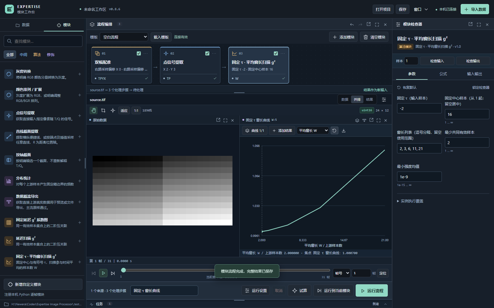

# 0.8.6 固定 τ 的 g² 平均窗长扫描

新增独立算法模块「固定 τ · 平均窗长扫描 g²」，标识 `correlation_window`。用户确认采用固定中心、扩大时间平均窗口；结果为 g² 随参与平均的样本数 W 的曲线。它复用公共 g² 实现、模块执行器和结果画布，不新增工作模式或独立播放器。

## 使用

在模块库「算法」中添加该模块，常用流程：

- 对应点：双幅配准 → 点信号提取（主路） → 固定 τ · 平均窗长扫描 g²。
- 区域强度信号：双幅配准 → ROI 裁剪 → 时序统计（均值或总和，主路） → 窗长扫描。
- 逐像素 g² 的空间平均：双幅配准 → ROI 裁剪 → 窗长扫描 → 时序统计（均值，主路）。

后两种估计不同，不互相替代。矩阵输入默认保留每个像素的 g²(W)，不会隐含区域归约；需要一条曲线时显式提取点或区域统计。

| 设置 | 含义 |
| --- | --- |
| 固定 τ | 右路索引 = 左路索引 + τ；支持负值、0、正值 |
| 固定中心 | 直接上游样本号，从 1 起；留空时选择可容纳最大窗口的有效区间中点 |
| 窗长范围 | 正整数下限、上限和步长；默认 3～101、步长 2，添加时按来源长度收紧 |
| 窗长列表 | 界面使用逗号分隔，例如 `2,3,6,11,21`；非空时覆盖范围，按唯一窗长升序计算 |
| 最少有效样本 | 小于该值的窗口不允许配置；实际共同有限配对不足时结果为 NaN |
| 最小强度均值 | 左右窗口均值均须大于阈值，否则无效 |

最多扫描 4096 个窗长。窗口和 τ 按直接上游样本计数；之前的时间裁剪、抽样和合帧会改变计数及真实时间。模块本身不先合帧、不插值、不额外归一化。中心留空时，试算、阶段计算与正式运行使用同一自动中心，预览光标不会改变它。

## 定义与边界

将界面中心转换为从 0 起的锚点 c。窗口的左路索引为

\[
I_W=\{c-\lfloor(W-1)/2\rfloor,\ldots,c-\lfloor(W-1)/2\rfloor+W-1\}.
\]

奇数窗口左右对称；偶数窗口比中心左侧在右侧多取 1 点。每个 W 使用同一个 c 和 τ，所有左右窗口都必须完整落在上游输入范围内；不足时报错，不缩窗、不补帧。

\[
g^{(2)}(W;c,\tau)=
\frac{\langle L_iR_{i+\tau}\rangle_{i\in V_W}}
{\langle L_i\rangle_{i\in V_W}\langle R_{i+\tau}\rangle_{i\in V_W}},
\quad
V_W=\{i\in I_W:L_i,R_{i+\tau}\text{ 同时有限}\}.
\]

分子与分母使用同一有效配对集合，不使用 Pearson 相关系数，也不将结果裁剪到 −1～1。固定 τ 表示固定上游样本偏移；非均匀时间下，每个 W 的实际配对时差可能不同，逐窗记录均值、最小 / 最大值和已知时间配对数。`known_pairs` 指时间已知的配对数，不冒充光强有效样本数。

输出样本轴为 `W`（平均窗长），不冒充时间 `T` 或延迟 `Q`。输出为无量纲标准 g²；区域信号和逐像素后处理保留各自含义。不能将 W 当时间轴抽样或播放；可按 W 轴明确提取截面。多个实例、复制和启停沿用公共流程规则，不兼容连接会指出具体模块。

## 保存、预览及导出

- 标量结果直接在公共曲线窗显示 g²(W)；逐像素结果沿窗长定位，后置空间统计可变为单条曲线。
- 横轴采用实际 W；曲线叠加要求类型、点数和全部窗长坐标一致。W 不能与 T / Q 或实际时间坐标混叠，也不会自动截短或插值。
- `values.npy` 保留全部数值，`measurements.csv` 增加 `window_samples` 并保存 τ、真实时差及信号值；原有 T / Q 导出列保持兼容。
- `references.jsonl` 逐窗保存中心、W、τ 和左右配对范围；运行记录保存完整上游模块、参数、实际后端及资源计划。
- 曲线附 PNG / SVG，截流 CSV 与完整比较包均使用实际 W；网页显示抽样不影响完整数值导出。

增长窗口使用已有累加量增量扩展，内存保留量与空间形状相关，不随最大 W 线性增长。CPU 完整可用；可选 GPU 复用相同计算定义及现有设备流水线。真实 CUDA 硬件检查在无可用设备时明确跳过，主机设备适配器不代表 CUDA 性能。

## 验证

专项 `test_correlation_window.py` 覆盖独立直接公式、正 / 零 / 负 τ、奇偶及非等距 W、共同无效值、随机访问、上游合帧、非均匀真实时间、区域两种估计、参数 / 窗口边界、CPU / 设备调度、试算与正式一致、CSV / SVG / 截流导出及叠加轴校验。

本机专项 18 项通过、1 项 CUDA 真机测试跳过；共享关联、设备流水线与多曲线比较的相关回归 102 项通过、2 项原有 CUDA 真机测试跳过。没有使用主机适配器结果宣称 CUDA 硬件性能。

`smoke_correlation_window.py` 在独立服务和模拟数据上，从模块编辑器完成添加、运行、预览、完整比较包下载及 1600×1000 / 1024×768 检查；确认无隐藏任务。临时结果仅写入被忽略的 `.test-output`，不改动实验文件。
