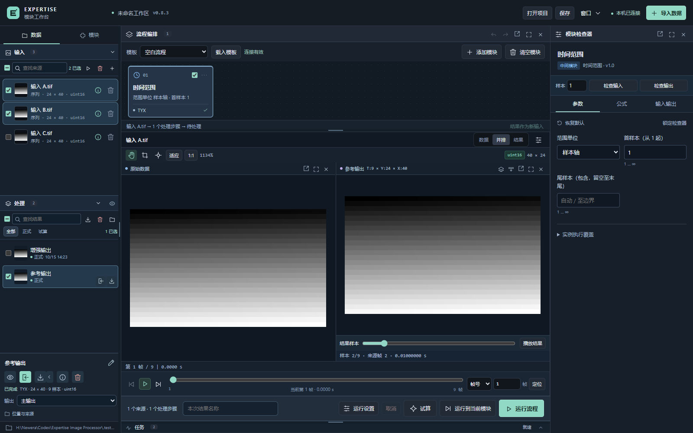

# 0.8.3 布局与数据管理

本版以 0.8.1 的主工作台结构重做布局。按查看、配置处理、验证结果的使用顺序分配空间：数据导航在左侧，公共预览居中，所选模块参数在右侧；任务历史按需查看。

## 布局

| 区域 | 内容与交互 |
| --- | --- |
| 左侧「数据」 | 纵向排列「输入」「处理」，各有数量、独立展开 / 收起、搜索及批选 |
| 左侧「模块」 | 与数据页并列，查找、分类和添加模块；切换不改变输入与结果预览 |
| 中央上方 | 编排、拖动及检查实际执行的模块流程 |
| 中央主体 | 原始数据和结果独立视窗，共用原有画布、帧定位与播放 |
| 中央底部 | 运行控制及 28 像素任务窄栏，展开任务区域限于 96–160 像素 |
| 右侧 | 所选模块参数、公式和输入输出；小窗口默认收起，按需打开 |

取消 0.8.2 的底部数据面板。左栏默认显示，可调整宽度；输入与处理结果始终属于同一个「数据」选项卡。中间分界支持拖动、方向键调整及双击恢复，比例随布局保存。标题折叠只收起对应列表，另一组获得空出的高度。结果最大化时仍可从左侧切换条目。

## 输入与处理结果

- 点击条目直接预览，勾选框仅改变所属组的批选。两组不混选，切换至模块页仍保留选择与结果样本位置。
- 输入工具栏可运行所选来源、移除来源引用或导入文件。已有结果及派生来源不阻止移除原始来源引用；活跃任务占用时显示具体任务。
- 处理工具栏可筛选正式 / 试算结果、合并打包下载、移除所选记录或恢复历史结果。文件夹图标可选择「导出文件夹」，递归找回其中的运行记录，也可逐项选择「运行记录」。
- 选中结果后，在列表下方改名、预览、作为新输入、导出或查看完整参数；常用操作使用带提示与无障碍名称的图标，位置和来源按需展开。
- 批量移除保留文件和来源快照；逐项永久清理仍需检查文件位置、依赖并确认。试算结果不能作为正式输入。

统一内存、缓存、显存与设备预算仍在「运行设置」。本次布局不改变科学计算、数据数值或显示与算法输入的隔离规则。

找回历史目录只读取运行记录、登记引用，不复制数组或重新处理数据。支持模块数据集、分幅结果及早期 TIFF 序列；未完成的 `.partial` 运行按未完成状态登记，仍可检查记录并逐项确认清理。普通文件夹必须保留 EIP 的 `run.json` 才能识别为处理结果。找回的引用保存到当前工作区，重启后继续恢复。

结果列表沿用 64 项上限，找回历史目录不会挤掉已有记录；达到上限会提示先清理或移除记录后继续找回。目录扫描有时间和条目边界，权限、缺失记录及格式错误会显示路径和原因。真正释放磁盘空间需逐项选择「删除文件」，仅移除记录会保留文件；原始输入和被引用文件仍受保护。

## 布局保存与迁移

当前选项卡、分组折叠、侧栏宽度和任务栏状态随草稿及项目保存；批选为当前页面临时状态。键盘方向键可在侧栏选项卡间切换，侧栏和任务区域的分隔线支持方向键调整。

布局格式升级至 schema 6，兼容 0.8.1 的 schema 4 及 0.8.2 的 schema 5。旧布局首次打开采用新的侧栏宽度、数据页与紧凑任务栏，保留模块流程、来源引用、显示、资源设置及分组折叠；不会恢复底部数据面板或自动重新计算。

## 验证

完整 CPU / API 回归：229 项通过、1 项可选 CUDA 测试按本机条件跳过。以下三个独立浏览器流程全部通过：

- `smoke_sidebar_data_0_8_3.py`：1600×1000 / 1024×768 布局、左侧层级、任务区域大小、独立折叠与批选、播放位置、所选输入运行、精确运行包内容、引用移除及旧布局迁移。
- `smoke_result_interaction_0_8_1.py`：公共结果画布、搜索、键盘、重命名、所选输出导出、复用、逐项清理与历史恢复。
- `smoke_module_revision_0_7_4.py`：模块目录、参数精度、统计数值、清空撤销及参数引用。

全部使用独立服务和模拟数据，不修改实验原始文件。截图及临时输出写入被忽略的 `.test-output`，首页截图展示模拟序列。

可拖动分界与历史导出文件夹的后续小修按用户要求未重跑验证，以上验收记录对应原始 0.8.3 发布。
