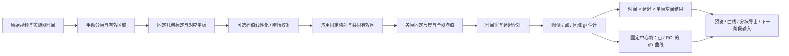

# 分幅强度关联模式：算法与界面规划

日期：2026-10-09。状态：0.4.0 已实现 CPU 基线和专用工作台，覆盖完整统计、双向延迟图、独立点 / ROI 曲线及结果串联。使用、存储和验证边界见 [0.4.0 说明](SPLIT_CORRELATION_0_4_0.md)。本文保留长期设计；时间—延迟概览、仿射 / 非刚性及模型配准、Zarr 和真实 GPU 验证仍待实施。

## 已确认的目标

用户的数据由分幅器采集，同一帧左右两幅对应同一对象，但偏振波前不同。手动划分左右幅、去除黑边，精细配准后做各幅预处理，计算对应像素随时间变化的二阶强度互关联。预览和处理始终在同一工作流中。

本轮用户已确认：

- 主结果采用标准归一化二阶互关联 g²，而不是 Pearson r 或未归一化协方差。
- 每幅使用在全序列上确定的固定线性尺度，不逐帧重设强度范围。
- 几何错位基本固定，一次标定后用于整段视频。
- 两路光程差尚不确定，延迟必须覆盖负值、0 和正值，支持反向延迟配对；不能只计算非负延迟，也不能假设正负曲线对称。
- 除随时间变化的系数图外，新增独立结果：固定中心帧、指定像素点或 ROI 的 g²(τ) 曲线，可显示、保存并导出。
- 算法阶段模块化，可替换传统方法或模型；CPU 完整可用，GPU 可选。

首版采用有符号整数帧延迟，另展示实际帧时间差；默认最近邻，亚像素双线性需显式选择。输入默认标记保存码值，可由用户确认线性强度或提供 LUT。插值是否符合实验，以及 CINE 保存码值与光强的线性关系仍需实验确认。延迟上下限、窗口长度和步长通过试算确定，不从采集帧率推定相关时间。

## 数据流与模块



实现顺序按依赖推进，但每个模块有独立参数、版本、输入输出和质量报告：

| 模块 | 输入与职责 | 输出 / 用户可检查内容 |
| --- | --- | --- |
| 分幅与掩膜 | 原帧、手绘两点中线、左右有效矩形及排除区域 | 左右候选区、固定黑边掩膜、原图坐标 |
| 几何标定 | 单帧 / 显式选定的参考帧及左右区域 | 变换矩阵或坐标场、控制点、有效重叠区、质量报告 |
| 强度校准 | 保存码值及可选相机 LUT、暗场资料 | 明确数值语义的强度数组；无资料时标明码值分析 |
| 应用几何映射 | 传感器空间的校准强度、固定映射、插值策略 | 左幅参考网格上的双幅数组、采样支持域与对应关系 |
| 固定尺度 | 每幅全序列统计，用户选择的尺度定义 | 左右各自的常量尺度、统计范围与诊断图 |
| 均值与涨落 | 全部输入帧、固定配准和掩膜 | 左右时间平均图、带正负值的涨落、有效计数 |
| 窗口 / 延迟计划 | 输入分析区间、窗口 W、中心步长 S、有符号延迟列表 | 正 / 反向精确帧配对、公共有效中心、输出数量与预算 |
| 关联估计 | 对齐强度及涨落、窗口、延迟、共同有效样本 | g² 图、有效样本数、低信号 / 无效掩膜 |
| 曲线估计与提取 | 固定中心帧、点 / ROI、有符号延迟、已声明的区域估计方式 | g²(τ)、有效计数、ROI 统计语义；独立计算或从已有结果提取 |
| 结果与存储 | 系数图 / 曲线、空间映射、时间配对、完整配置 | 分块数据集、可追溯预览、曲线表 / 图、选定延迟序列及导出 |

这里的“预先裁剪左右幅”是算法输入语义，与通用模式的“完整图像处理后 ROI 裁剪输出”不同，必须使用独立的配置和界面文字。

## 1. 手动分幅、裁黑边与精细配准

画布先显示完整原帧，提供可移动、可调整端点的中线。两侧有效矩形分别可编辑，边界吸附仅作为建议。黑边识别基于参考图提出外边界候选，用户可修正；不根据每帧暗像素动态删除对象内部，否则会改变统计样本。

以左幅为参考坐标，右幅映射到左幅。先检查两路是否镜像 / 翻转，保存显式方向变换。几何标定优先拟合低自由度模型：平移 → 小角度刚性 / 受限仿射。传统候选为结构特征匹配与 RANSAC 初始化，再用相位相关或 ECC 细化；具体方法通过真实样本决定。相位相关适合平移估计，ECC 提供多种运动模型并需要合理初值与收敛检查。[OpenCV 相位相关](https://docs.opencv.org/4.x/d7/df3/group__imgproc__motion.html)、[OpenCV ECC](https://docs.opencv.org/4.13.0/dc/d6b/group__video__track.html)

配准目标是结构对齐，不是把两路随时间的强度涨落调成一致。默认固定整段变换，不逐帧以最终 g² 最大化为目标重新对齐。保留人工对应点修正；模型匹配器、局部畸变坐标场作为后续可替换实现，需要额外质量验证。

“逐像素对应”用左像素到右幅连续坐标的映射表示。若允许双线性等亚像素插值，右侧值来自相邻像素加权，不再是单个传感器像素的保存值；插值、权重、边界支持域均进入记录。提供整数平移 / 不插值对照，不能用“亚像素”宣称所有对应点已经真实准确。

几何标定可使用辅助结构图估计映射；正式数值路径先在传感器原始像素上做已确认的线性化 / 暗场处理，再应用固定映射重采样。非线性 LUT 与插值不应颠倒顺序。仅为人工检查生成的配准预览不冒充正式数值预处理结果。

有效分析区是两幅掩膜和变换支持域的交集。矩形输出外形由共同有效区裁剪，内部无效位置保留掩膜，不填 0 冒充测量。标定检查采用叠加闪烁、棋盘格、结构差异、对应点残差和未参与拟合的控制点；单一亮度差分不足以判断偏振通道的几何误差。

## 2. 固定尺度、全帧均值与 g² 的关系

先明确用于关联的强度数值。当前 CINE 读取器保留保存码值，不自动线性化；10 位打包布局本身不能证明码值与光强线性。相机线性化 / 暗场校准属于独立模块，不能用显示伽马替代，也不能猜测查找表。[Phantom CINE 格式说明](https://phantomhighspeed.my.salesforce-sites.com/servlet/fileField?id=0BE1N000000kD2i)

对实际文件 `F:/Data-test/Test1/22741_1_4.cine` 的只读头部检查得到 RealBPP=10、BlackLevel=64、WhiteLevel=1014、fGamma≈2.22、ShutterNs=9500、EDRShutterNs=0、AutoExposure=0、SoftwareVersion=806。官方说明中的 10 位打包路径可能由更高位线性数据经过压扩编码而来，需用相应逆 LUT 恢复；该样本的黑电平与此路径相符，仍需通过相机导出设置或 SDK / 线性导出样本对照确定。fGamma 是显示处理元信息，不能据此直接计算逆幂函数。首版应保留原码值与校准强度的独立语义，未确认时明确标为“码值关联”。曝光字段若有逐帧记录，也需检查实际曝光是否稳定，不只依赖单个 SETUP 值。

0.4.0 固定尺度采用每幅全源时间涨落 RMS，也可不缩放。每幅一个常量，不强制每个对应像素的均值 / 波动相等。纯乘性尺度会在标准 g² 中约去；加性偏置、剪裁、逐帧拉伸和非线性映射则可能改变结果，必须单独声明。固定尺度可帮助数值条件和预处理比较，不能被描述成必然改善 g²。

以下 J_L、J_R 表示在同一空间网格上的、采用已声明校准及固定尺度的强度。每个像素的全源均值为：

\[
B_L(p)=\frac{1}{M}\sum_{i=0}^{M-1}J_L(p,i),\qquad
B_R(p)=\frac{1}{M}\sum_{i=0}^{M-1}J_R(p,i).
\]

对应涨落是 δ_L = J_L − B_L、δ_R = J_R − B_R。浮点计算保留负值；不能沿用会裁剪到无符号整数范围的逐帧强度变换。全帧均值包含静态对象信息，界面应称“时间平均基线”，与单独测得的探测器暗背景区分。

对中心 c、窗口 W_c、右路有符号帧延迟 q，已确认的主估计量是：

\[
g^{(2)}(p,c,q)=
\frac{\langle J_L(p,i)J_R(p,i+q)\rangle_{i\in W_c}}
{\langle J_L(p,i)\rangle_{i\in W_c}\,
 \langle J_R(p,i+q)\rangle_{i\in W_c}}.
\]

以左路时间为基准：q>0 时取较晚的右路帧，q<0 时取较早的右路帧，q=0 为同一采集帧。记录实际时差 τ_i=t_R(i+q)−t_L(i)，并显示符号约定。负延迟按真实帧配对计算，不翻转正延迟结果代替；左右路互换对照时，也须调整参考窗口中心，不能在同一有限窗口上简单更换符号。

为了保留用户要求的均值去除阶段，等价实现可用涨落，但必须对当前窗口再计算涨落均值：

\[
C_{c,q}=\langle\delta_L\delta_R^{(q)}\rangle_W
-\langle\delta_L\rangle_W\langle\delta_R^{(q)}\rangle_W,
\quad
g^{(2)}=1+\frac{C_{c,q}}
{(B_L+\langle\delta_L\rangle_W)(B_R+\langle\delta_R^{(q)}\rangle_W)}.
\]

这是对上述用户选定公式的代数重写，不增加额外物理假设。只计算全均值残差的乘积，通常不等于 g²−1，因为滑动窗残差均值不一定为 0。基线、强度均值与涨落各自保留，避免近零残差均值成为分母。

无效数据策略显式配置：分母过小、样本不足、NaN / Inf 等位置标为无效并导出掩膜。若开启坏点或饱和排除，左右均值、乘积和协方差使用同一联合有效样本集合及同一个计数，不独立删除导致分母与分子来自不同帧。标准 g² 不使用 Pearson 的 −1～1 范围裁剪。

背景默认用整个输入来源的全部帧，分析可只选其中一段。参考图可抽样用于配准，但抽样背景必须标为近似，不能与全帧背景下的正式结果混同。时间平均作为局部统计估计，窗口长短与漂移、独立样本数量应通过诊断曲线评估；采集帧数多不代表这些样本完全独立。

## 3. 中心窗口、延迟扫描和有效边界

首版建议奇数 W = 2h+1，以实际左路中心帧作为输出时间。窗口中心步长 S 和延迟步长 Δq 是不同参数，界面分别标明“输出时间步长”和“延迟扫描步长”。

建议先支持帧延迟区间 q_min≤q≤q_max、步长 Δq>0 及有符号显式列表，例如 −100～+100 帧。范围可非对称；跨过 0 的扫描显式包含 q=0，步长未命中时在列表中单独加入，不悄悄改变其他延迟间隔。所有延迟按数值排序，保存实际列表而不只保存范围。右幅始终取 i+q，不将负值转为绝对值。选择按秒扫描时，必须定义时间配对容差与变帧率策略；不把平均帧率换算值当成精确时差。帧延迟模式也保存实际 t[i+q]−t[i]，显示其范围与代表值。

当输入分析区间为 [a,b)、q_min / q_max 为实际延迟列表的最小 / 最大值，令 D_−=max(0,−q_min)、D_+=max(0,q_max)，建议默认所有延迟使用公共有效中心：

\[
c_k=a+h+D_-+kS,\qquad c_k\le b-1-h-D_+.
\]

设 N = b−a，输出窗口数为 K = 1+floor((N−W−D_−−D_+)/S)，要求 N≥W+D_−+D_+。仅 q=0 时两端各去 h；包含负延迟时头部另去 D_−，包含正延迟时尾部另去 D_+。对称扫描 −Q～+Q 时两端各去 h+Q。步长不能整除时，最后一个实际输出中心还会更早。运行前显示第一 / 最后中心、左右输入覆盖区和真实时间，不复制原始帧时间轴冒充结果时间轴。

公共区间让不同延迟可以直接比较；后续如需要每个延迟自己的最大时间范围，应明确输出的缺失区域和不同有效数量。先不悄悄为大延迟缩短窗口、补零或延拓边界。

输出数据的逻辑轴为：**输出时间 × 延迟 × 左幅参考 Y × 左幅参考 X**。延迟是独立轴，不编码成颜色通道，也不拼入普通视频帧号。

### 固定中心帧的点 / ROI 延迟曲线

新增独立任务与结果类型：用户锁定中心帧 c、选择一个或多个点 / ROI、设置 W 与正负延迟列表，得到 g²(c,τ) 曲线。“固定帧”定位统计窗口中心，仍使用完整 W 帧估计每个延迟，不用单帧乘积冒充区间平均。左窗口为 [c−h,c+h]，右窗口为 [c−h+q,c+h+q]；固定中心下可覆盖的帧延迟满足 a−c+h≤q≤b−1−c−h。越界时提示调整中心或范围，保持 W 不变，不自动缩短窗口或补零。

点曲线读取参考网格上所选像素的 g²(c,q)。ROI 提供两种明确命名的方式，不能互相替代：

1. **逐像素 g² 的空间平均**：在固定有效像素集合 P 上计算 mean_{p∈P} g²(p,c,q)，作为系数图对应 ROI 的默认曲线。默认采用本次延迟列表共同有效的像素集合，以免曲线变化来自参与像素数变化；记录原 ROI 数量、参与数量和排除原因。无有效像素时输出无效状态。
2. **区域总强度的 g²**：先计算 S_L(i)=Σ_{p∈P}w_p J_L(p,i)、S_R(i+q)=Σ_{p∈P}w_p J_R(p,i+q)，再计算 ⟨S_L S_R⟩_W/(⟨S_L⟩_W⟨S_R⟩_W)。两路使用相同的固定有效区域和权重，默认等权；坏点 / 缺失处理保持区域定义及联合时间样本一致，不随帧改变区域大小。该估计量含空间交叉项，结果不能由逐像素 g² 图简单平均得到。

曲线可独立计算，也可从已有同配置四维结果中提取点曲线 / 逐像素空间平均；已有结果须包含所选中心、延迟和区域，缺失部分按需计算，不对时间或延迟轴插值冒充原始估计。区域总强度曲线需要区域强度统计，不能从系数图反推。独立任务复用同一标定、全源固定尺度与基线，处理所选区域及其映射支持域，不要求先生成整个视频的四维结果；只做局部任务时仍说明全源统计是否已完成。ROI 空间平均先确定共同有效像素集合，再分块聚合，必要时分两遍处理，保证有界内存与固定统计语义同时成立。

输出包括交互曲线、数值 CSV、曲线图 PNG / SVG 与配置 JSON。CSV 保存点 / ROI 标识、估计方式、中心帧及实际时间、窗口边界、带符号帧延迟、实际时差代表值 / 范围、g²、联合有效样本数及参与像素数 / 无效原因。ROI 逐像素平均采用各像素有效计数摘要，不能将空间像素数当成时间样本数。图中横轴显示有符号 τ 或帧延迟单位，纵轴为 g²，标出 τ=0 与 g²=1；缺失值形成断点。点坐标、ROI 几何、空间映射、权重、来源与完整预处理参数进入配置，保证重开和导出可复现。

## 4. 模式界面

在主工作台顶部增加“通用图像处理 / 分幅强度关联”模式切换，各模式保留自己的配置和来源视图状态。沿用本机导入、任务队列、播放、显示与项目管理，主画布和右侧配置按当前步骤重组。

```text
顶部：数据 / 项目 | 模式：分幅强度关联 | 当前标定与运行状态
左侧：输入来源、标定记录、平均图、关联结果、来源链
中央步骤：分幅与配准 → 预处理检查 → 关联试算 → 结果
中央画布：原帧中线 / 左右对应图 / 配准叠加 / 系数图或固定帧延迟曲线
右侧：当前步骤参数、质量、有效范围、计算与输出预算
底部：输入时间 / 输出中心时间、窗口覆盖、延迟选择、任务进度与取消
```

| 步骤 | 中央检查 | 右侧主要操作 |
| --- | --- | --- |
| 分幅与配准 | 原帧中线、左右同步预览、对应点 / 叠加 | 左右有效区、方向、标定模型、人工微调、接受当前标定 |
| 预处理 | 两路强度、全帧平均图、正负涨落与统计 | 校准资料、固定尺度、全源统计进度、失效 / 过期状态 |
| 关联试算 | 当前中心窗口、当前 / 若干 τ 的系数图与曲线 | W、S、带符号延迟上下限 / 列表、信号阈值、设备与内存预算 |
| 结果 | 单幅系数图、固定帧点 / ROI 延迟曲线、ROI 的时间—延迟概览 | 中心帧锁定、点 / ROI 选择及估计方式、时间播放、τ 切换、曲线 / 数据导出 |

结果视图提供“系数图 / 固定帧延迟曲线 / 时间—延迟概览”切换。切换 τ 时仅加载当前时间的一张二维图；播放时固定 τ，不自动遍历两条轴。曲线视图先锁定中心帧，再点击像素或绘制 / 修改 ROI，可叠加多个点 / ROI 作比较。曲线游标可联动相应 τ 的系数图；若仅完成曲线任务，该图需要另行按需计算，不假装已经生成。时间—延迟概览可导航到对应系数图。ROI 视图和导出始终标明估计方式。

延迟控件接受负下限、正上限、非对称范围及稀疏列表，显示“负：右路较早 / 正：右路较晚”。曲线任务展示固定中心和完整左右窗口覆盖，单独设置延迟扫描步长；输出时间步长 S 仅在多中心任务中生效，固定中心任务不显示无作用的 S 控件。

分幅 / 标定视图默认同帧查看；结果核验视图则明确显示左中心 c 和右中心 c+q 的实际时间，标出两侧窗口覆盖。点击结果像素可回看两个原始传感器坐标及右路插值支持域，不将有延迟的两幅标记为同一时刻。

显示提供 g²=1 的基准与固定色标，涨落预览用以 0 为中心的色标；无效像素用独立图案 / 透明图层呈现。浏览器接收当前切片、曲线和概览，不接收整段四维数组。科学数值和所有显示映射继续分开。

“当前帧试算”在该模式下变为“当前中心窗口试算”，明确列出实际 W 帧和选择的 τ。只有采用同一已完成标定、完整背景、尺度与参数时，试算才能标为与正式运行一致；近似试算显示缺少的全局上下文。改标定 / 裁剪使下游统计过期，改 W/S/τ 可复用既有全源统计，改色标只影响显示。

## 5. 计算、存储和设备

先实现可人工核对的 CPU 参考计算，再优化，不采用每个滑窗重新从头平均的正式实现。候选优化：短 / 稀疏延迟用分块滚动统计，长且密集延迟用零填充的局部时间 FFT 互相关；两者使用同一配对和归一化定义，通过实测选择，不使用循环卷积混入头尾数据。

内存按时间块、延迟批次和必要空间块分配，含配准 halo，以及右路前向 / 后向覆盖所需的 W+D_−+D_+ 时间跨度。窗口 / 延迟缓冲超过预算时改用可重读数据或磁盘工作块，不无条件把全部所需帧放入内存。CPU 默认 float64 累计；优化实现检查长期更新漂移，必要时重新累计。导出 float32 或 float64 的选择、误差与实际设备进入记录。

增加 S 会减少输出和部分窗口计算，但全源背景扫描仍要读取所有帧；滚动统计也可能仍遍历这些帧。因此不承诺计算量与 S 成严格反比。高帧率相邻帧的微秒采样间隔不等于算法输出的真实时间分辨率；W 的平滑和 S 的采样要同时展示。

**容量示例，非用户已选参数：** N=370,801、W=1,001、S=100、延迟 −100～+100 帧每 1 帧一步、单幅有效区假设 128×128，则 K=3,697、201 个延迟，需 743,097 张系数图。float32 未压缩系数本身约 **48.70 GB（45.36 GiB）**，还未计掩膜与元信息。相比原先仅 0～100 帧约 24.48 GB 的估算，双向扫描接近两倍。独立固定中心、单点曲线只输出 201 个系数，ROI 空间平均可边算边聚合，均无须保存这套完整四维系数图；读取、标定和全源统计成本仍需单独预算。

0.4.0 先用 `.npy` 磁盘映射保存 TQYX 系数和计数数组，按切片写入 / 读取，不生成数十万个 TIFF 小文件；独立曲线任务不生成四维数组。后续评估 Zarr 压缩 / 分片，记录轴、每窗时间、延迟与有效计数。切片导出支持 TIFF、曲线 / 索引 CSV 与运行 JSON；全四维 TIFF 或视频导出不作为首版默认。[Zarr 分块数组文档](https://zarr.readthedocs.io/en/stable/user-guide/arrays/)

正式运行提供四种范围：单窗口少量延迟试算、固定中心帧的点 / ROI 曲线、少量中心的多延迟预览、确认参数后的全场全区间扫描。若只计算 ROI，需要保存两路对应支持域，逐像素结果与全场切出同一 ROI 保持一致；区域总强度估计独立验收。先探索正负延迟范围，再选合适密度；可手动用稀疏列表做粗扫，但不替用户猜测物理相关时间。

设备抽象设 CPU / Auto / 可用 GPU。CPU 保证全功能；CuPy/CUDA 可作为 NVIDIA GPU 的候选适配器，安装和驱动是可选条件，不把普通电脑排除。设备探测、显存预算和小型自检在运行前完成；Auto 无 GPU 时选择 CPU，显式选 GPU 却不可用时说明原因。运行中失败的回退 / 重试必须记录，不能静默混合不同精度结果。[CuPy 安装与兼容条件](https://docs.cupy.dev/en/stable/install.html)

GUI 预检展示有效像素、窗口数、延迟数量、逻辑数据大小、内存 / 显存需求和实测短任务速度。长任务分别报告标定、全源均值、关联和输出进度，支持检查点取消；失败或取消输出沿用 `.partial` 标记，不成为正式下一阶段输入。

## 6. 当前框架要扩展的边界

| 当前 0.3.1 | 本模式新增能力 |
| --- | --- |
| 单张 frame 插件，要求保持空间尺寸 | 配准模块、序列统计模块、双路窗口估计模块，分别声明形状与坐标 |
| ROI 作为处理后的输出裁剪 | 先分幅 / 建立配对有效区，再选择参考空间分析 ROI |
| 一帧对应一帧结果 | 一张图对应 W 个左输入帧及其延迟右帧，使用 WindowRef |
| 普通图像 / TIFF 序列结果 | 多轴 CorrelationResult，二维切片展示与选定 τ 的派生序列 |
| 结果主要为图像 / 序列 | 独立 CorrelationCurveResult：固定中心、点 / ROI、带符号延迟轴、估计方式与有效计数 |
| 输入和结果共用简单场景坐标 | 原图、左右幅、参考网格、输出裁剪之间的显式变换 |
| 试算只读当前帧 | 试算读取窗口且依赖完整标定 / 全源统计缓存 |
| 仅 CPU 的内置执行 | 共享数值定义的 CPU / 可选 GPU 后端与资源计划 |

建议集中到 `src/eip/modes/split_correlation/`，含配置模型、几何、标定、强度校准、归一化、背景、关联、存储及执行计划；前端使用独立模式控制模块，调用已有文件选择和任务服务。运行入口按模式分派，原逐帧插件契约继续保留；新插件明确声明 scope、算法版本和所需统计上下文，不把多帧缓存隐藏在无声明的 process(frame) 中。

缓存键包括来源修订、数值校准、分幅区域、标定映射、有效掩膜、统计范围和算法版本；相机 / 插值 / 背景变化使后续缓存失效。项目增加版本化模式配置，旧项目默认为通用模式，大数组和标定图存外部制品而不是 JSON 内嵌。

结果记录左右窗口开始 / 结束（结束不含）、左中心帧 / 实际时间 / 采集源帧号、带符号右路延迟及实际时差、有效数量和完整空间映射。曲线结果另记录固定中心、点 / ROI 定义、权重与区域估计方式；带符号延迟轴、曲线样本和配置均进入项目，重开后保持一致。选择“当前 τ 序列作为下一阶段输入”后，输出成为参考网格上的时间序列并保留 WindowRef 和标定来源；用户无需回到原始双幅重新猜对应关系。

## 7. 分阶段实施与验收

1. **数值契约与参考内核**：确定尺度定义、时间配对、插值和码值校准；建立可人工核对的双路小序列、中心窗口、正 / 零 / 负延迟和 g² 参考公式，同时验证点与两种 ROI 曲线定义。交付配置 / 结果模型与 CPU 参考脚本，尚不跑用户整段大任务。
2. **分幅标定与模式 GUI**：中线、左右有效区、固定配准、质量检查及同步预览；接入整段均值统计、当前窗口的双向延迟试算及固定中心点 / ROI 曲线显示与 CSV 导出。交付从导入到可信试算的闭环。
3. **可用正式处理**：有界 CPU 分块计算、多轴存储、时间 / 延迟导航、独立曲线任务与 PNG / SVG 导出、来源记录、项目重开。交付建议 0.4.0 模式基线；GPU 接口同时预留。
4. **性能与算法实验**：用真实文件测读取、插值、关联和写盘占比，再接 GPU / FFT、改进特征或模型配准。对同一小样本逐项比较数值和空间误差，不以总用时替代正确性验收。

科学验收包括：

- 常量正强度 g²=1；固定通道增益不改变 g²；显式偏置校准按数学结果改变。
- 已知相同 / 反向涨落和人为延迟的小序列与直接求和相同；漂移序列验证全源去均值与局部协方差重写的等价性。
- 正 / 负已知延迟均准确配对；在非对称小序列上验证不镜像曲线，左右互换时使用对应的移位中心验证一致性。
- 已知亚像素变换和固定黑边的合成双幅，检查坐标、边界和插值对统计的影响；真实标定采用独立控制点 / 校准结构，记录未确定的匹配区域。
- W、S、q_min / q_max 的中心数、两端丢弃、首尾时间、非对称正负范围、跨零列表、延迟步长与窗口步长准确；缺帧 / 不均匀时间不产生伪造秒值。
- 近零分母、饱和、坏点、无效掩膜、不足 W+D_−+D_+ 的序列及固定中心越界均有明确输出 / 拒绝行为。
- 固定中心单点曲线与四维结果取该像素一致；ROI 空间平均与同配置系数图平均一致，区域总强度 g² 与先求和再直接计算一致，两种定义有可区分的合成例子。
- 曲线图、CSV 和项目重开保留同一带符号延迟轴、固定中心 / 窗口、点 / ROI 坐标、单位、数值、无效状态及估计方式。
- 精确试算与正式处理同一切片一致；分块策略、CPU / GPU、直接 / FFT 的结果在已声明精度范围内一致，重点检查相邻块边界。
- 真实 CINE 按需读取，内存 / 显存不随完整视频长度增长；四维结果不整体送往浏览器；取消后缓存和设备资源能释放。
- 两种常见窗口宽度下完成分幅、标定、试算、切换时间 / 正负延迟、锁定中心帧、点 / ROI 曲线显示和导出及重开；模式切换和旧项目 / 旧逐帧算法回归通过。

本规划只承诺实施后验证的强度互关联估计，不从示意图推断实际配准精度、最佳平均帧数或最优延迟范围。所有实验参数及替换算法仍以实际数据评估。
